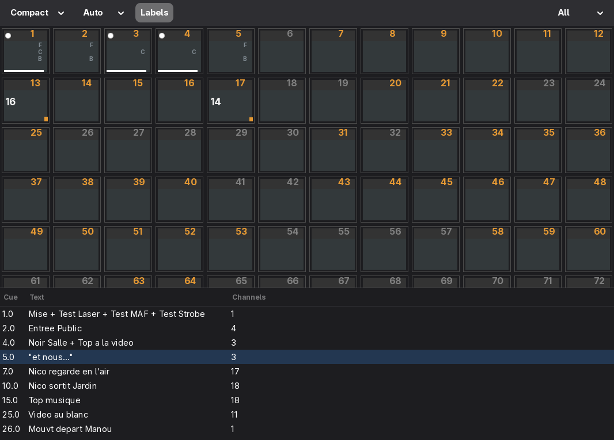

[Français](../doc.fr/cues.md) | [← Table of Contents](index.md)

# 11. Cues

The **Cues** tab provides direct access to every stored lighting cue and its captured channels:

## Layout

- **Top Pane (`ChannelsView`)**: renders channel states for the cue selected below using standard view controls (`Compact` / `Summary+` / `Table`, `Auto / Label / Ref / Percent / DMX`, `Labels`, and Flexi filters).
  - Intelligent fixtures display `F`, `C`, `B` activity dots, live color bars, and cue state indicators.
- **Bottom Pane**: lists cues with **`Cue`** number, **`Text`** description, and **`Channels`** count.

## Creating, Updating & Deleting Cues

- **From the Command Line**:
  - `RECORD 12` or `RECORD CUE 12 TIME 6`: stores current output as cue `12`.
  - `UPDATE 12` or `UPDATE`: updates cue `12` or the currently active cue.
  - `DELETE 12`: deletes cue `12`.
  - `GOTO 12` or `GOTO CUE 12 TIME 2`: executes a direct jump to cue `12`.
- **Direct Editing**: select any row in the cue list to inspect, label, or adjust stored channel levels directly.

---

*Previous: [10. Parametric Effects](effects.md) — Next: [12. Sequences, Tracking & MIB →](sequences.md)*
