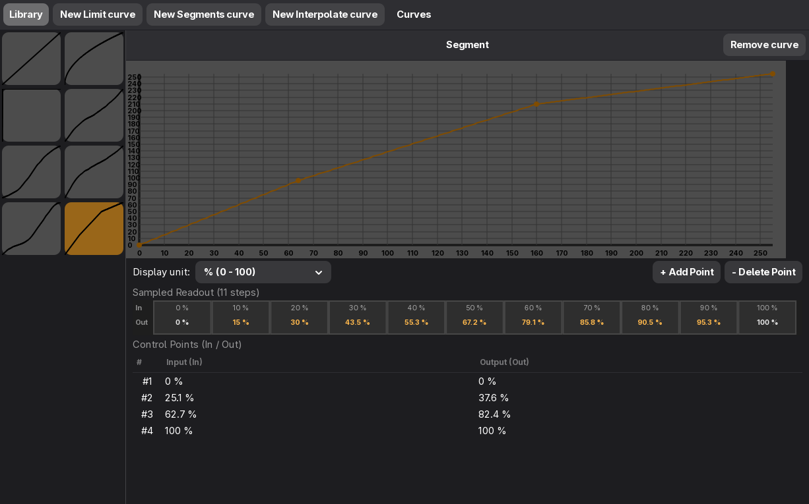

[Français](../doc.fr/curves.md) | [← Table of Contents](index.md)

# 14. Dimmer Curves (`Curves`)

The **Curves** tab lets you inspect and build custom response curves mapping logical channel levels to physical DMX output (`0..255`), assignable in the `Patch` tab:

## Top Bar & Collapsible Library

- **`Library`**: toggles the left thumbnail sidebar so you can maximize canvas width during editing.
- **`New Limit curve`**: creates a ceiling/limiting dimmer curve.
- **`New Segments curve`**: creates a piecewise-linear curve joined by draggable breakpoints.
- **`New Interpolate curve`**: creates a smoothly interpolated curve through control points.
- **`Remove curve`**: deletes the active custom curve.

## Interactive Graph & Readout Controls

- **Interactive canvas (`0..255` input/output axes)**: drag points directly with the pointer (press `Delete` to remove a selected point).
- **`Display unit`**: switches numerical readouts between **`% (0 - 100)`** and **`DMX (0 - 255)`**.
- **`+ Add Point` / `- Delete Point`**: adds or deletes control points precisely.
- **`Sampled Readout (11 steps)`**: displays output values at every `10 %` step (`0 %` through `100 %`).
- **`Control Points (In / Out)`**: editable table listing every exact `(In, Out)` breakpoint (`#1`, `#2`, …).

---

*Previous: [13. Multi-Page Faders](faders.md) — Next: [15. Track Channels →](track_channels.md)*
