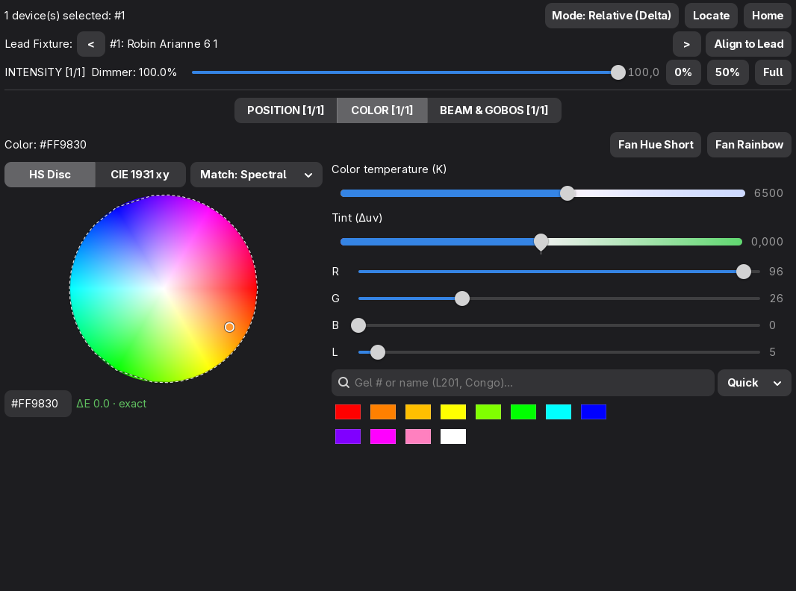

[Français](../doc.fr/device_inspector.md) | [← Table of Contents](index.md)

# 7. Device Inspector

The **Device Inspector** tab (`Shift+Ctrl+I`) provides unified IFCB (*Intensity, Focus/Position, Color, Beam*) control for all selected intelligent fixtures:

## Selection Header & Master Intensity

- **Multi-fixture selection & `Lead Fixture`**: shows selected fixture count; `<` and `>` buttons step through the active lead fixture.
- **`Align to Lead`**: copies parameter values from the lead fixture across the selection.
- **`Mode: Relative (Delta)`** / Absolute: switches multi-fixture edits between relative offsets and uniform absolute targets.
- **`Locate`** & **`Home`**: brings fixtures to their locate preset/values or resets attributes to *Home*.
- **`INTENSITY` slider + `0%`, `50%`, `Full` quick buttons**: direct dimmer or virtual dimmer control.

## `POSITION` Family

- Interactive **XY Pan/Tilt pad** with live reticle feedback.
- Precision **16-bit `Pan` and `Tilt` rotary encoders** (`Fine 16-bit (0.05°)` toggle), **Center**, **Invert**, and multi-fixture **Fan** controls.

## `COLOR` Family (N-LED Color Picker & Colorimetry)

Handles RGB, RGBA, RGBW, RGBL/RGBAL, RGBAW, and CMY fixtures through a multi-emitter **NNLS solver**:

- **`HS Disc` / `CIE 1931 xy` views**: pick colors on a hue/saturation wheel or directly on the CIE 1931 chromaticity diagram showing the fixture's physical gamut hull.
- **Conversion strategy (`Match: Spectral`, etc.)** alongside live hex value and color error metric (**$\Delta E$**).
- **`Color temperature (K)`** slider and green/magenta **`Tint (Δuv)`** offset.
- **Individual emitter faders** (`R`, `G`, `B`, `L`, `W`, `A`, …).
- **Color Fanning**: **`Fan Hue Short`** and **`Fan Rainbow`** distribute smooth gradients across multi-fixture selections.
- **Gel Swatchbook Search (`Lee`, `Rosco`)**: search by code or name (e.g. `L201`, `Congo`) plus quick swatch buttons.

## `BEAM & GOBOS` Family

Centralizes optical parameters exposed by the active fixture profile: **`Zoom`**, **`Focus`**, **`Iris`**, **`Strobe`**, **`Frost`**, **`Gobo`** selector/indexing, and **`Prism`**.

---

*Previous: [6. Fixture Library & GDTF](fixtures.md) — Next: [8. Palettes & Presets →](palettes.md)*
