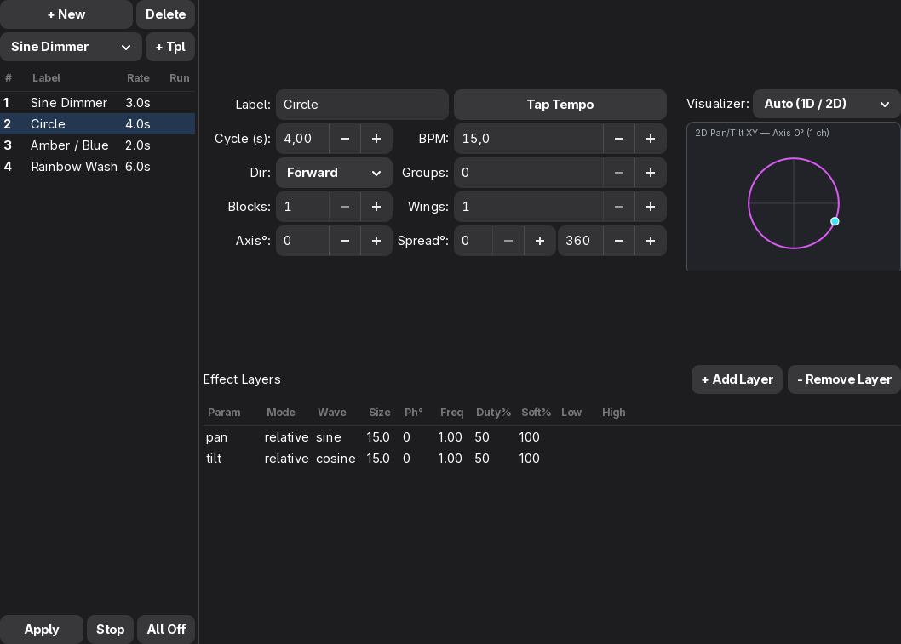

[Français](../doc.fr/effects.md) | [← Table of Contents](index.md)

# 10. Parametric Effects (`Effects`)

Open Lighting Console replaces legacy static chasers with a real-time **44 Hz floating-point parametric effects engine** (`Shift+Ctrl+E` or `Alt+E`):

## Pool & Built-In Templates (`+ Tpl`)

The left pool lists show effects (`#`, `Label`, `Rate`, `Run`). Use **`+ New`** to create an empty effect, **`Delete`** to remove it, or **`+ Tpl`** to instantiate one of the **10 built-in templates**:

| Template ID | Effect Description |
| ----------- | ------------------ |
| `sine_dimmer` | Smooth sine wave dimmer modulation |
| `chase_cancan` | Step-based intensity chase |
| `candle_flicker` | Organic candle-like intensity flicker |
| `circle` | 2D circular `Pan` / `Tilt` trajectory (sine + cosine) |
| `figure_8` | Figure-8 (`1:2` Lissajous) `Pan` / `Tilt` path |
| `tilt_wave` | Vertical wave on `Tilt` |
| `fly_in_out` | Synchronized intensity + `Tilt` sweep |
| `two_color_chase` | Two-color alternating chase |
| `rainbow` | Continuous hue/RGB spectrum rotation |
| `zoom_pulse` | Periodic `Zoom` pulsing |

Bottom controls (**`Apply`**, **`Stop`**, **`All Off`**) run the selected effect on the active selection, stop it, or halt all running effects.

## Timing & Spatial Distribution

- **`Label`**: effect name.
- **`Tap Tempo`**: matches cycle BPM to your clicking tempo.
- **`Cycle (s)`** & **`BPM`**: cycle period in seconds or beats per minute (linked dynamically).
- **`Dir`**: traversal direction (`Forward`, …).
- **`Groups`**, **`Blocks`**, **`Wings`**: distribute phases across adjacent sub-groups, synchronous blocks, or mirrored wings.
- **`Axis°`** & **`Spread°`**: 2D rotation axis angle and phase spread window across fixtures (e.g. `0°` to `360°`).

## Live `Visualizer` & `Effect Layers`

- **`Visualizer`**: switches between **`Auto (1D / 2D)`** (draws a **2D Pan/Tilt XY Cairo plot** as shown above, or waveforms when non-XY) and **`1D Waveform`** (time-domain plots per layer).
- **`Effect Layers` table** (`+ Add Layer`, `- Remove Layer`): stack one or more editable parameter layers:
  - `Param` (`intensity`, `pan`, `tilt`, `color`, `zoom`, …)
  - `Mode` (`relative`, `absolute`, …)
  - `Wave` (`sine`, `cosine`, `triangle`, `square`, …)
  - `Size`, `Ph°` (phase offset), `Freq` (frequency multiplier), `Duty%`, `Soft%`, `Low`, `High`.

## Cue Tracking, Faders & CLI

- **CLI**: `<selection> EFFECT 2` starts effect `2`; `STOP EFFECT 2` or `STOP` stops it.
- **Sequences & Tracking**: effect start/stop events record into cues and track downstream in Tracking mode (`FX` column in `Sequences`).
- **Faders**: assigning an **`Effect`** to a fader lets you control **`Mode: Size`**, **`Mode: Rate`**, or **`Mode: Size+Rate`** live.

---

*Previous: [9. Groups](groups.md) — Next: [11. Cues →](cues.md)*
