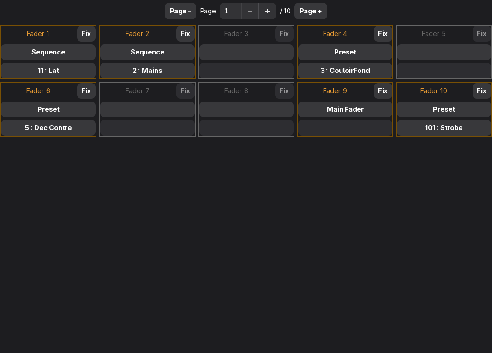

[Français](../doc.fr/faders.md) | [← Table of Contents](index.md)

# 13. Multi-Page Faders (`Faders`)

The **Faders** tab (`Shift+Ctrl+F`) configures banks of **10 faders per page**, mirrored across Virtual Console, MIDI, and OSC:

## Multi-Page Navigation

The top bar navigates between pages (page count and *Skip empty fader pages* behavior are configurable in **Preferences → General**):

- **`Page -` / `Page +`**: step backward or forward one page.
- **`Page <n> / <total>` spinbox**: jump directly to any page number.

## Fader Slot Configuration

Each slot presents:

- **`Fader <N>` header + `Fix` toggle button**: enabling **`Fix`** pins that fader slot identically across **all fader pages** (ideal for keeping `Main Fader`, key washes, or global effects permanently on hand).
- **Type Selector**:
  - *(empty)*: unassigned slot.
  - **`Preset`**: plays back a stored `Preset` (HTP intensity + attributes).
  - **`Sequence`**: assigns an auxiliary cue sequence (e.g. `2 : Mains`, `11 : Lat`).
  - **`Effect`**: drives a parametric effect live with **`Mode: Size`**, **`Mode: Rate`**, or **`Mode: Size+Rate`** and channel scope controls.
  - **`Main Fader`**: acts as grand master output dimmer.
- **Content Selector**: picks the target `Preset`, `Sequence`, or `Effect`.

---

*Previous: [12. Sequences, Tracking & MIB](sequences.md) — Next: [14. Dimmer Curves (Curves) →](curves.md)*
