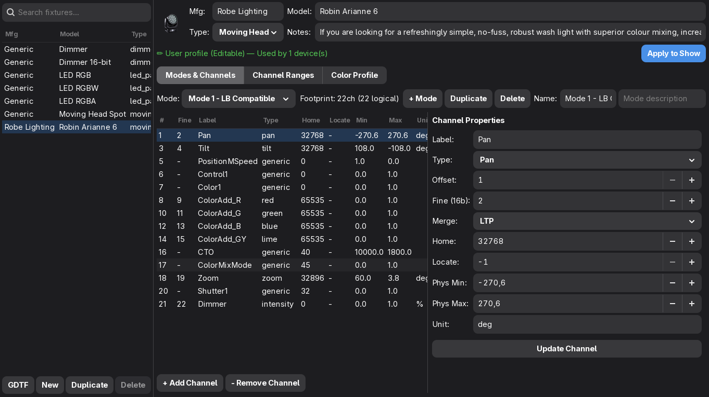

[Français](../doc.fr/fixtures.md) | [← Table of Contents](index.md)

# 6. Fixture Library & GDTF (`Fixtures`)

The **Fixtures** tab (`Shift+Ctrl+P`) hosts the built-in catalog, user fixture definitions, and DIN SPEC 15800 (`.gdtf`) importer:

## Left Catalog

- **Search bar (`Search fixtures...`)**: live-filters by manufacturer (`Mfg`), model (`Model`), or fixture type (`Type`).
- **Columns**: `Mfg`, `Model`, `Type`, `Used` (count of devices currently patched in the show).
- **Library actions**:
  - **`GDTF`**: imports a `.gdtf` manufacturer archive (**DIN SPEC 15800**) via `pygdtf` (8/16-bit channels, multiple modes, channel ranges, and color primaries).
  - **`New`**: creates a blank editable user fixture profile.
  - **`Duplicate`**: clones any built-in fixture definition so you can customize it.
  - **`Delete`**: removes a user fixture definition.

## Right Profile Editor

Any user-editable profile (`User profile (Editable)`) can be modified live:

- **Metadata**: `Mfg`, `Model`, `Type` (`Moving Head`, `dimmer`, `led_par`, …), `Notes`.
- **`Apply to Show`**: pushes profile changes immediately to matching patched devices in the current show without repatching.
- **`Modes & Channels` sub-tab**:
  - Manage DMX modes (`Mode`, `+ Mode`, `Duplicate`, `Delete`, `Name`, `Mode description`) with live `Footprint` calculation.
  - Edit channels table (`#`, `Fine`, `Label`, `Type`, `Home`, `Locate`, `Min`, `Max`, `Unit`) with `+ Add Channel` and `- Remove Channel`.
  - **`Channel Properties` panel**: edit `Label`, `Type`, `Offset`, `Fine (16b)`, `Merge` (`LTP` / `HTP`), `Home`, `Locate`, `Phys Min`, `Phys Max`, `Unit`, and apply with **`Update Channel`**.
- **`Channel Ranges` sub-tab**: defines discrete functional ranges (gobo wheels, color wheels, shutter/control ranges) shown in `Device Inspector`.
- **`Color Profile` sub-tab**: configures emitter spectral/CIE primaries and white points for the N-LED colorimetry solver.

---

*Previous: [5. Patch & DMX Outputs](patch.md) — Next: [7. Device Inspector →](device_inspector.md)*
