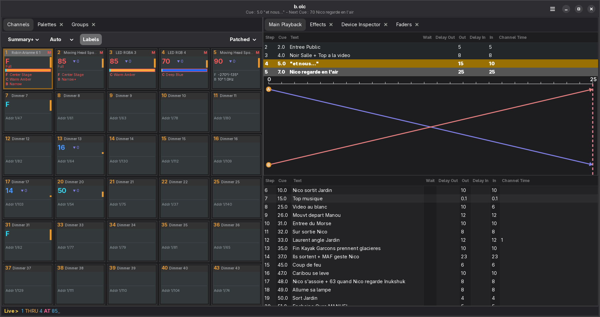
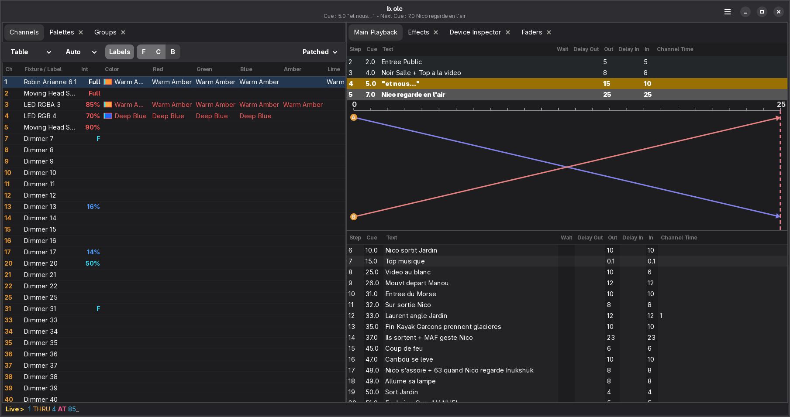

[Français](../doc.fr/general.md) | [← Table of Contents](index.md)

# 2. Main Window & Live Views (`LiveView`)

## Overall Layout

The Open Lighting Console main window pairs two resizable panes separated by a central vertical divider (`Gtk.Paned`), topped by a header bar and anchored at the bottom by the full-width command line:

- **Header Bar**: shows the active show filename (e.g. `b.olc`), live subtitle (`Cue : 5.0 "..." - Next Cue : 7.0 ...`), the application menu button, and window controls.
- **Left Pane (`LiveView`)**: hosts the **`Channels`** tab and any editor tab moved to the left pane.
- **Right Pane (`Playback`)**: hosts **`Main Playback`** — previous cue list on top, **A/B Crossfade** graph in the center, upcoming cue list below — along with additional editor tabs.
- **Command Line (bottom)**: shows the active prompt (`Live >`), syntax-highlighted command tokens, and inline auto-completion suggestions.

## Tab Management

All tabs opened from the application menu (`Patch`, `Fixtures`, `DMX Outputs`, `Curves`, `Cues`, `Groups`, `Palettes`, `Effects`, `Sequences`, `Faders`, `Track Channels`, `Independents`, `Device Inspector`, `History`, `Preferences`) share flexible placement:

- **`Shift+Tab`**: moves the active tab between the left pane and the right pane so you can view any two editors side by side (e.g. `Channels` next to `Effects` or `Device Inspector`, or `Palettes` beside `Main Playback`).
- **`Ctrl+W`**: closes the active tab (except permanent `Channels` and `Main Playback`).
- Open tabs, pane assignments, and divider position persist inside `.olc` show files.

## LiveView Display Controls

The toolbar above the **Channels** grid controls visual density and filtering:

### 1. Display Format (`Shift+Alt+F`)
- **Compact**: high-density grid tiles showing channel number, intensity value, level bar, `F` / `C` / `B` dots, and color swatch.
- **Summary+**: expanded tiles displaying fixture labels, full color bar, and readable text summaries (referenced `IP`/`FP`/`CP`/`BP` palette labels or physical Pan/Tilt/Zoom/Strobe values).
- **Table**: structured row-by-row table with collapsible parameter family columns (`F` Focus, `C` Color, `B` Beam), dynamic per-parameter columns matching patched fixtures, and live color swatches.

### 2. Readout Mode (`Shift+Alt+D`)
Switches how parameter data is rendered across tiles and table cells:
- **Auto**: displays referenced palette/preset labels when linked, otherwise formatted physical values.
- **Label**: displays fixture/palette labels.
- **Ref**: displays short reference codes (`IP1`, `FP1`, `CP1`, `BP1`, `PR1`).
- **Percent**: forces percentage readouts (`0..100` / `F`).
- **DMX**: forces raw DMX readouts (`0..255` / `0..65535`).

### 3. Labels & Flexi Filters
- **`Labels` button (`Shift+Alt+L`)**: toggles custom fixture/channel labels on or off.
- **Flexi Filter (`Ctrl+F`)**: cycles through channel visibility presets:
  - **All**: every channel up to `MAX_CHANNELS`.
  - **Patched**: patched channels only.
  - **Active**: channels currently above zero or transitioning.
  - **Devices**: multi-parameter intelligent fixtures only.
  - **Selected**: currently selected channels only.
  - **Manual**: channels holding manual operator edits only.

## General & Navigation Keyboard Shortcuts

| Shortcut | Action |
| -------- | ------ |
| `Ctrl+O` / `Ctrl+S` / `Shift+Ctrl+S` | Open / Save / Save As |
| `Shift+Ctrl+O` | Import USITT ASCII show |
| `Ctrl+Z` / `Shift+Ctrl+Z` (`Ctrl+Y`) | Undo / Redo |
| `Ctrl+W` / `Shift+Tab` | Close active tab / Move active tab to opposite pane |
| `F11` / `F3` / `Ctrl+Q` | Fullscreen / About / Quit |
| `Ctrl+F` | Cycle Flexi filter (`All`, `Patched`, `Active`, `Devices`, `Selected`, `Manual`) |
| `Shift+Alt+F` / `Shift+Alt+D` / `Shift+Alt+L` | Cycle Format (`Compact`/`Summary+`/`Table`) / Readout Mode / Labels |
| `Shift+Ctrl+B` | Global **Blackout** (DBO) |
| `Ctrl+A` / `Ctrl+Up` / `Ctrl+Down` | Select all active channels / Level `+ %` / `- %` |
| `Space` or `Ctrl+G` / `Ctrl+B` / `Ctrl+Space` | **Go** / **GoBack** / **Pause** on `Main Playback` |
| `Alt+Down` / `Alt+Up` | Next / Previous Step, Cue, Group, or Palette |
| `Shift+Up` / `Shift+Down` | Previous / Next command line history entry |
| `Arrows`, `PageUp`, `PageDown` | Navigate channel grid |
| `F2` / `Insert` / `Delete` | Rename / Insert Cue or Channel Time / Delete selected item |

### Direct Tab Shortcuts

| Shortcut | Tab |
| -------- | --- |
| `Ctrl+P` / `Shift+Ctrl+P` / `Ctrl+D` | `Patch` / `Fixtures` / `DMX Outputs` |
| `Shift+Ctrl+G` / `Shift+Ctrl+L` / `Shift+Ctrl+E` | `Groups` / `Palettes` / `Effects` |
| `Ctrl+T` / `Shift+Ctrl+T` | `Sequences` / `Track Channels` |
| `Ctrl+F` *(Flexi)* / `Shift+Ctrl+F` / `Ctrl+I` | Flexi Filter / `Faders` / `Independents` |
| `Shift+Ctrl+I` / `Shift+Ctrl+C` / `Shift+Ctrl+H` | `Device Inspector` / `Virtual Console` / `Undo History` |

---

*Previous: [1. Introduction](intro.md) — Next: [3. Command Line (CLI) →](commandline.md)*
