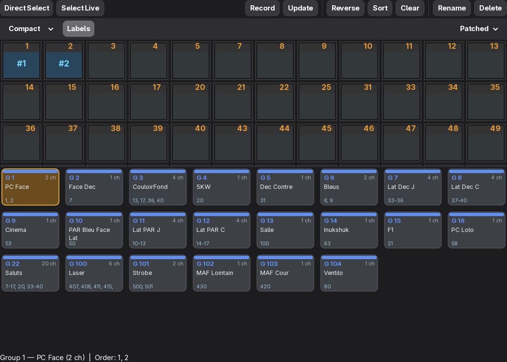

[Français](../doc.fr/groups.md) | [← Table of Contents](index.md)

# 9. Groups

The **Groups** tab (`Shift+Ctrl+G`) stores **ordered channel selections** (without intensity levels) to speed up programming, live selection, fanning, and effect distribution:

## Visual Grid & Selection Order Badges

- The top pane embeds a **`ChannelsView`** grid with view controls (`Compact` / `Summary+`, `Labels`, Flexi `Patched`, …).
- **Order badges (`#1`, `#2`, …)**: channels belonging to the selected group show numbered badges reflecting exact selection order (essential for chases, color fans, and effect phase distribution).
- The bottom pane displays group tiles (`G 1 — PC Face — 2 ch — 1, 2`) plus a summary line showing the active group name, channel count, and exact ordered sequence (`Order: 1, 2`).

## Toolbar Actions

- **`Direct Select`**: clicking a group tile immediately selects its channels in `LiveView` in order.
- **`Select Live`**: pushes the currently selected group's channel list into `LiveView`.
- **`Record`** / **`Update`**: creates a new group from the current selection or overwrites the selected group.
- **`Reverse`**: reverses channel order (`1, 2, 3, 4` -> `4, 3, 2, 1`).
- **`Sort`**: sorts or reorders channels numerically / according to current order.
- **`Clear`**: clears the active channel selection in the editor.
- **`Rename`** (`F2`) / **`Delete`** (`Delete`): renames or deletes the selected group.

## Equivalent CLI Commands

- Recall selection: `GROUP 1` or `G 1 THRU 3`
- Record / Label: `RECORD GROUP 10 LABEL "Front"`
- Update / Rename / Delete: `UPDATE GROUP 10`, `LABEL GROUP 10 "Back"`, `DELETE GROUP 10`

---

*Previous: [8. Palettes & Presets](palettes.md) — Next: [10. Parametric Effects →](effects.md)*
