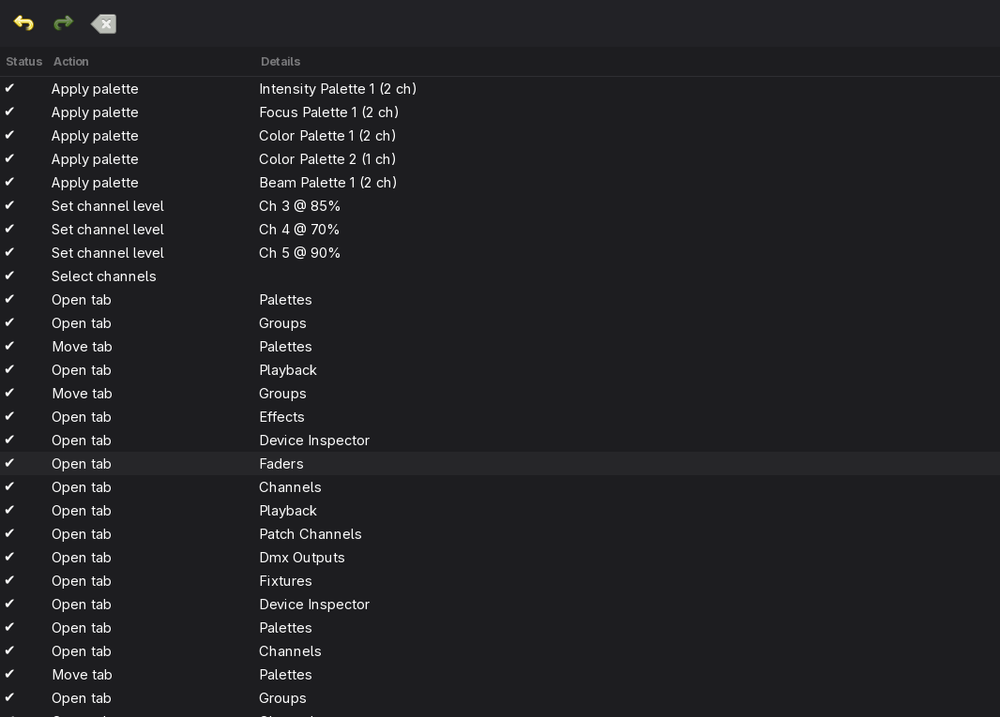

[Français](../doc.fr/history.md) | [← Table of Contents](index.md)

# 18. Undo History

The **Undo History** tab (`Shift+Ctrl+H`) displays the chronological stack of reversible actions:

## Controls

- **Top Toolbar**:
  - **Undo (`Ctrl+Z`)**: reverts back prior to the selected action.
  - **Redo (`Shift+Ctrl+Z` / `Ctrl+Y`)**: reapplies undone actions.
  - **Clear History**: clears the current undo stack.
- **Readable Action Log**: shows status (`✓` applied), human-readable action label (`Apply palette`, `Set channel level`, `Select channels`, `Open tab`, `Move tab`, …), and detailed context (`Intensity Palette 1 (2 ch)`, `Ch 3 @ 85%`, …).

---

*Previous: [17. Virtual Console](virtual_console.md) — Next: [19. Preferences →](settings.md)*
