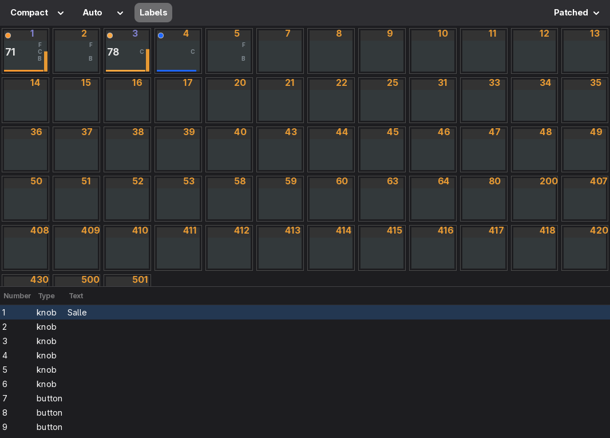

[Français](../doc.fr/independents.md) | [← Table of Contents](index.md)

# 16. Independents

The **Independents** tab (`Ctrl+I`) provides **6 persistent auxiliary channels** unaffected by cue playback (`Main Playback`) or the `Main Fader`—commonly used for house lights, hazers/fans, or stage worklights:

## Configuring an Independent

- **Bottom list**: displays channels `1` through `6` with an editable **`Type`** selector (**`knob`** for proportional rotary control `0..100 %`, mapped to the upper amber-ring encoders in Virtual Console, or **`button`** for on/off switches below) and editable **`Text`** label (`F2`, e.g. `Salle`).
- **Top `ChannelsView`**: highlight an independent in the list, set desired channel levels above, and update/store (`U` key).

## Live Control

- **Virtual Console**: rotary knobs (top row) and buttons (bottom row).
- **Command Line**: `INDEPENDENT <n> AT <level>`.
- **OSC**: `/olc/independent/<n>/level`, `/olc/independent/<n>/button`, and `/olc/independent/dump`.

---

*Previous: [15. Track Channels](track_channels.md) — Next: [17. Virtual Console →](virtual_console.md)*
