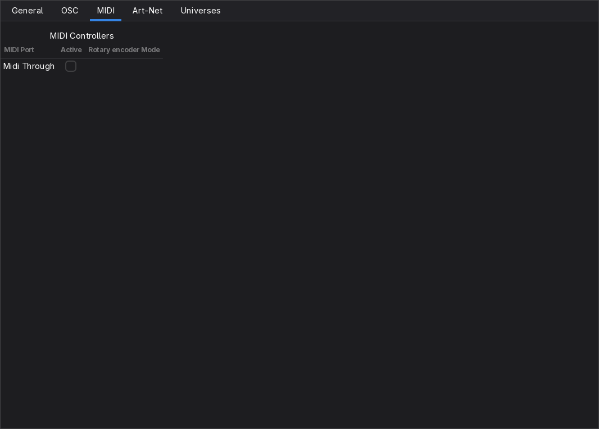

[Français](../doc.fr/midi.md) | [← Table of Contents](index.md)

# 20. MIDI & Mackie Control Surfaces

Open Lighting Console supports generic **MIDI** controllers as well as motorized **Mackie Control Universal (MCU)** surfaces powered by `mido` and `python-rtmidi`.

## Port Activation & Rotary Encoder Modes

Under **Preferences → MIDI**:
1. Enable **`Active`** on each target MIDI port (`Midi Through` appears even without physical hardware connected).
2. Set **`Rotary encoder Mode`** to match your hardware's endless encoder encoding:
   - **`Relative 1`** *(Two's complement)*: `1..63` increments, `65..127` decrements.
   - **`Relative 2`** *(Sign bit)*: `1..63` / `65..127` per sign-bit / offset encoding.
   - **`Mackie`**: relative *V-Pot* encoding used by Mackie Control devices.
   - **`Absolute`**: standard `0..127` continuous controllers.

## Interactive MIDI Learn

No manual mapping file is required:
1. Open the **Virtual Console** (`Shift+Ctrl+C`).
2. Toggle **`MIDI`** in the title bar.
3. Click any virtual control (fader, Flash button, independent knob/button, `Go`, `Pause`, `Go Back`, …).
4. Move or press the physical control on your MIDI surface; bindings are saved per page/control inside your `.olc` file.

## Motorized Feedback, LEDs & `MackieLCD`

When your hardware supports bidirectional feedback:
- **Faders & Flash LEDs**: page switches, cue recalls, and GUI edits transmit updated *Control Change* and *Note* feedback to sync motorized faders and illuminated buttons.
- **Mackie LCD (`MackieLCD`)**: automatically updates Mackie Control SysEx scribble strips with active fader labels.

---

*Previous: [19. Preferences](settings.md) — Next: [21. OSC, OSCQuery & TouchOSC →](osc.md)*
