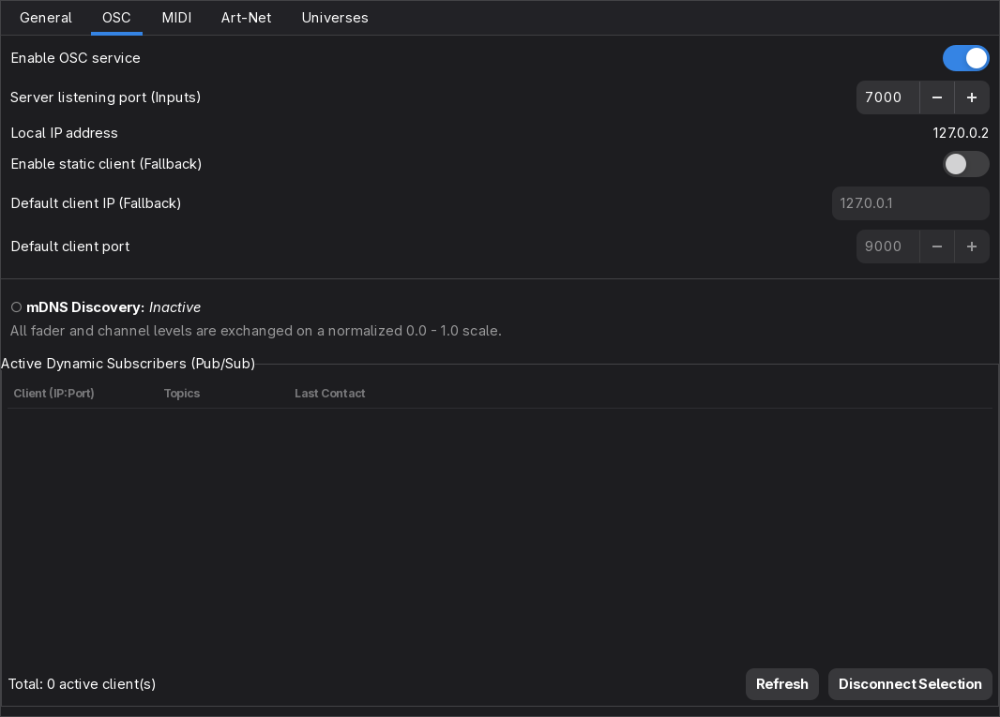

[Français](../doc.fr/osc.md) | [← Table of Contents](index.md)

# 21. OSC, OSCQuery & TouchOSC

Open Lighting Console embeds a bidirectional **`asyncio` OSC server** with **mDNS** discovery, an **OSCQuery** schema endpoint, dynamic **Pub/Sub** client subscriptions, and ready-to-use **TouchOSC** layouts.

## Network Configuration & Discovery

- **Server Listening Port**: defaults to `7000`.
- **Optional Static Fallback Client**: `127.0.0.1:9000` (`Enable static client (Fallback)`).
- **Normalized Scale**: all fader and channel levels use normalized **`0.0 .. 1.0`** floats.
- **mDNS & OSCQuery Discovery**: automatically advertises the OSC address tree (via `zeroconf` if installed, or the built-in pure-Python mDNS responder).
- **Dynamic Subscriptions (Pub/Sub)**: send `/olc/channels/subscribe` or `/olc/subscribe/status` to stream live console feedback; connected subscribers appear live in `Active Dynamic Subscribers` and can be disconnected individually.

## Bundled TouchOSC Templates

Pre-built layouts are included in `data/templates/touchosc/`:
- `OpenLightingConsole_Tablet.tosc`
- `OpenLightingConsole_Phone.tosc`

Both templates can be regenerated with `tools/generate_touchosc_templates.py`.

---

## OSC Route Reference (`/olc/*`)

### Channels, `LiveView`, Park, Sneak & Raw DMX
- **Subscriptions & Grid**: `/olc/channels/subscribe`, `/olc/subscribe/status`, `/olc/channels/page/+`, `/olc/channels/page/-`, `/olc/channels/start`, `/olc/channels/dump`, `/olc/channels/format`, `/olc/channels/data`, `/olc/channels/readout`, `/olc/channels/labels`, `/olc/channels/labels/toggle`, `/olc/channels/flexi`
- **Cells & Channels**: `/olc/cell/*/touch`, `/olc/cell/*/level`, `/olc/channel/*/touch`, `/olc/channel/*/level`
- **Park & Sneak**: `/olc/channel/*/park`, `/olc/channel/*/unpark`, `/olc/address/*/*/park`, `/olc/address/*/*/unpark`, `/olc/park/unpark_all`, `/olc/channels/sneak`, `/olc/channel/*/sneak`
- **Raw Universe Injection**: `/olc/universe/*/set_channels`, `/olc/universe/*/blackout`

### Selected Fixtures, Encoders & Device Attributes
- **Relative Encoders (`wheel`)**: `/olc/wheel/{intensity,pan,tilt,zoom,focus,iris,strobe,frost,gobo,prism,cct,kelvin}`, `/olc/wheel/param/*`
- **Active Selection (`selected`)**: `/olc/selected/{intensity,pan,pan/norm,tilt,tilt/norm,color/rgb,color/r,color/g,color/b,color/hue,color/sat,color/hsv,zoom,zoom/degrees,focus,focus/meters,iris,strobe,strobe/hz,frost,gobo,prism,color/kelvin,cct,home,locate}`, `/olc/selected/param/*`
- **Specific Device (`device/<id>`)**: `/olc/device/*/{zoom,focus,iris,strobe,frost,gobo,prism,pan,tilt,color/rgb,home,locate}`, `/olc/device/*/param/*`

### Playback, Faders & Independents
- **Sequences & Crossfade**: `/olc/key/{go,pause,goback,seq+,seq-}`, `/olc/playback/{goto_cue,goto,active/cue,next/cue,state,dump,xfade/a,xfade/b,xfade}`, `/olc/cue/dump`
- **Grand Master & Sync**: `/olc/mainfader`, `/olc/blackout`, `/olc/sync`
- **Faders**: `/olc/fader/{pageupdate,page,page+,page-}`, `/olc/fader/1/*/level`, `/olc/fader/1/*/flash`
- **Independents**: `/olc/independent/*/{level,button}`, `/olc/independent/dump`

### Keypad, Palettes, Effects & Patch
- **Keypad & CLI Triggers**: `/olc/key/{0..9,.,clear,enter,backspace,channel,all,at,level,full,thru,+,-,+%,-%,out,cue,record,update,delete,time,delay,group,sneak,check,record_cmd,update_cmd,palette,preset,intensity,focus,color,beam,effect}`
- **Effects**: `/olc/effect/{stop_all,tap_tempo,*/*}`
- **Palettes & Presets**: `/olc/palette/*/*`, `/olc/preset/*`
- **Patch**: `/olc/patch/{dimmer,device,unpatch,1on1,clear,curve,get,device/info,dump}`

---

*Previous: [20. MIDI & Mackie Control Surfaces](midi.md) — Next: [22. Companion Tools & Headless Architecture →](tools.md)*
