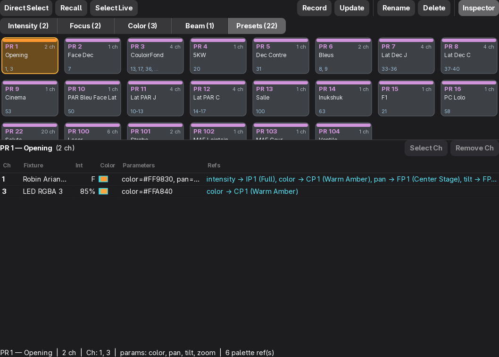

[Français](../doc.fr/palettes.md) | [← Table of Contents](index.md)

# 8. Palettes & Presets

The **Palettes** tab (`Shift+Ctrl+L`) organizes reusable attribute building blocks by IFCB family as well as multi-family `Presets`:

## Categories & Prefixes

Top category tabs filter stored entries with live counts:
- **`Intensity` (`IP`)**: intensity palettes.
- **`Focus` (`FP`)**: position palettes (`Pan`, `Tilt`).
- **`Color` (`CP`)**: color palettes (`#FF9830`, hues, emitter levels).
- **`Beam` (`BP`)**: optics/beam palettes (`Zoom`, `Focus`, `Iris`, `Strobe`, `Frost`, `Gobo`, `Prism`).
- **`Presets` (`PR`)**: combined multi-family presets capable of **cascading references** to palettes (`IP`, `FP`, `CP`, `BP`) as shown above (`color -> CP1 (Warm Amber)`).

## Recall Behavior & Controls

### Top Toolbar
- **`Direct Select`**: enables touch-style direct action — clicking any tile recalls the palette or preset immediately.
- **`Recall`**: applies the selected palette or preset.
  - **If channels are selected in Live**, values apply **only to the active selection**.
  - **If nothing is selected in Live**, the palette or preset applies to **all channels stored inside it**.
  - **LiveView feedback**: recalled live values turn **red (manual)** to indicate operator-controlled values until updated into a cue or released via `Sneak`.
- **`Select Live`**: selects all channels stored in the chosen palette/preset inside `LiveView`.
- **`Record`**, **`Update`**, **`Rename`**, **`Delete`**: capture live edits, propagate updates across dependent cues/presets, rename (`F2`), or delete items.
- **`Inspector`**: toggles the collapsible lower inspection panel.

## `Inspector` Panel & Summary Footer

With **`Inspector`** enabled, the bottom pane shows:
- **Item heading** (e.g. `PR 1 — Opening (2 ch)`).
- Local buttons: **`Select Ch`** (selects highlighted channels in LiveView) and **`Remove Ch`** (removes selected channel(s) from the palette/preset).
- Detailed channel table: `Ch`, `Fixture`, `Int`, `Color` swatch, `Parameters` (stored raw/physical values), and `Refs` (cascade reference chain `param -> IP/FP/CP/BP`).
- **Status footer**: one-line summary of ID, name, channel count, channel list, parameter families, and palette reference count.

## Equivalent CLI Commands

- Recall: `IP 1`, `CP 2`, `PR 1` or `1 THRU 4 CP 1`
- Record / Update / Delete: `RECORD CP 3`, `UPDATE PR 1`, `DELETE FP 2`

---

*Previous: [7. Device Inspector](device_inspector.md) — Next: [9. Groups →](groups.md)*
