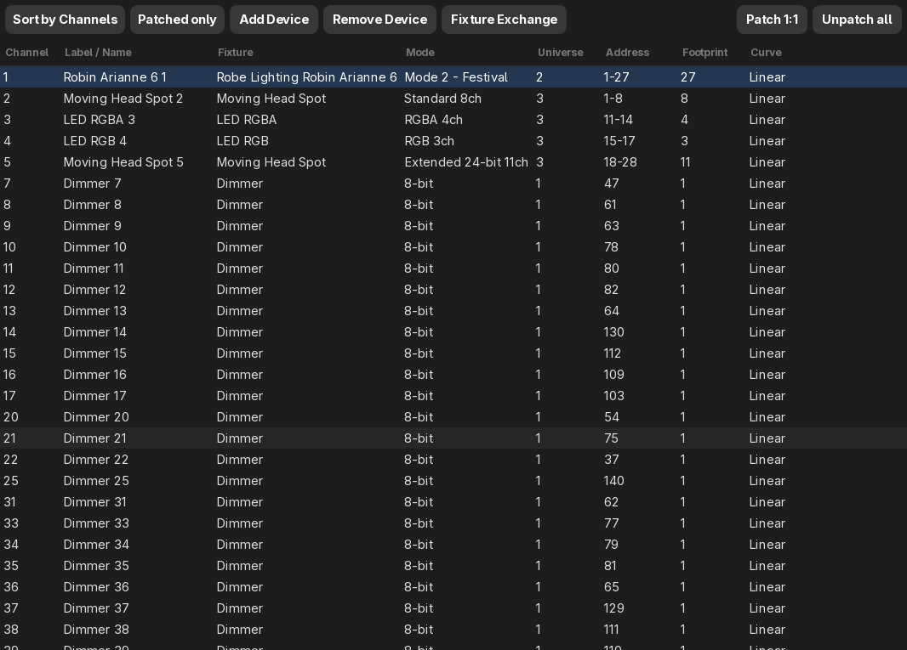
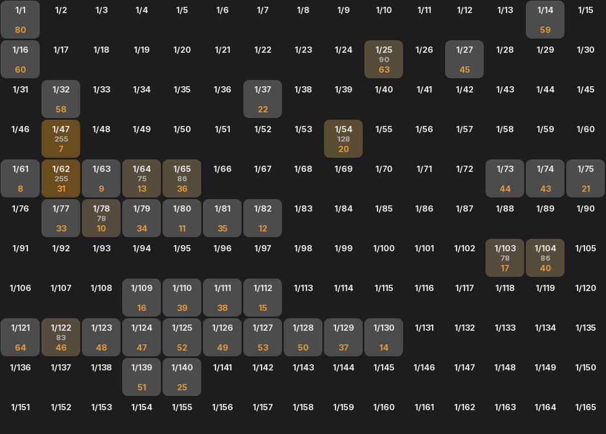

[Français](../doc.fr/patch.md) | [← Table of Contents](index.md)

# 5. Patch & DMX Outputs

## Patch Tab (`Ctrl+P`)

The **Patch** tab offers a device-centric overview of channels, intelligent fixtures, DMX addresses, and dimmer curves:

### Toolbar Actions
- **Sort Toggle (`Sort by Channels` / DMX address sort)**: switches row ordering and column layout between logical view (Channel first) and physical view (Universe / Address first).
- **Filter Toggle (`Patched only`)**: hides or shows unpatched channels.
- **`Add Device`**: launches the fixture patching dialog for one or more multi-parameter fixtures from the library (including `.gdtf` models), assigning channel IDs, DMX mode, universe, and non-overlapping addresses automatically.
- **`Remove Device`**: removes or unpatches the selected device.
- **`Fixture Exchange`**: swaps the fixture model or DMX mode of an already patched device while keeping its channel number.
- **`Patch 1:1`**: patches DMX addresses directly 1-to-1 with channels.
- **`Unpatch all`**: clears the entire patch (with confirmation dialog).

### Columns & Inline Editing
Each row shows **`Channel`**, **`Label / Name`**, **`Fixture`**, **`Mode`**, **`Universe`**, **`Address`**, **`Footprint`** (DMX channel count), and **`Curve`** (assigned dimmer curve).

- Click/double-click labels, fixtures, modes, addresses, or curves to edit via inline popovers.
- Command-line patching works identically:
  - `1 PATCH AT 1/10` or `21 THRU 24 PATCH AT 2/1`
  - `1 UNPATCH` or `ADDRESS 2/1 UNPATCH`

---

## DMX Outputs Tab (`Ctrl+D`)

The **DMX Outputs** tab renders a live matrix of all **512 DMX addresses** across configured universes:

- **Top header**: `Universe/Address` (e.g. `1/47`, `1/62`).
- **Center (white)**: current DMX output level (`0..255`, omitted when zero for readability).
- **Bottom (amber)**: patched logical channel number mapped to that address (e.g. `7` on `1/47`, `31` on `1/62`).
- **Live highlight**: active output tiles glow amber proportionally to their DMX output level.

---

*Previous: [4. Files, Formats & Import/Export](files.md) — Next: [6. Fixture Library & GDTF →](fixtures.md)*
