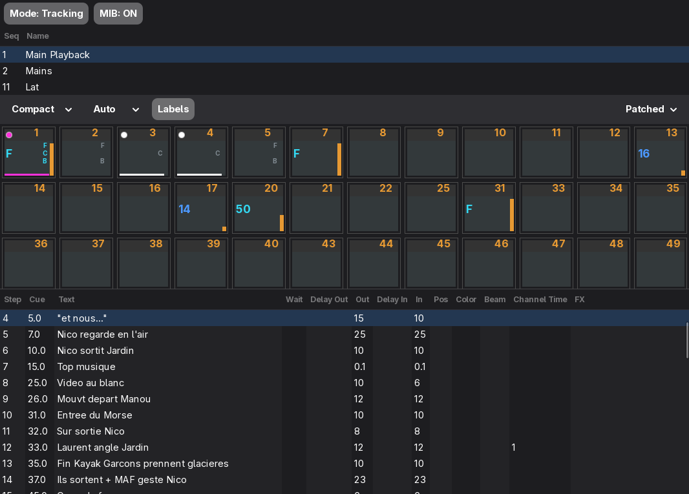

[Français](../doc.fr/sequences.md) | [← Table of Contents](index.md)

# 12. Sequences, Tracking & MIB (`Sequences`)

The **Sequences** tab (`Ctrl+T`) edits `1 Main Playback` as well as auxiliary sequences assignable to faders:

## Playback Modes (`Tracking` & `MIB`)

Two toggle buttons at the top configure the active sequence:

- **`Mode: Tracking` / `Mode: Cue-Only`**:
  - **Tracking** preserves channel values and running effects downstream across subsequent cues until explicitly changed, blocked (`Block`), or brought to zero.
  - **Cue-Only** isolates edits strictly to the edited cue without propagating downstream.
- **`MIB: ON` / `MIB: OFF` (*Move In Black*)**:
  - Look-ahead automation pre-positions intelligent fixture parameters (Pan/Tilt, Color, Beam) **while intensity is at 0 %** ahead of their next active cue, preventing visible transitions during fade-in.

## Layout

1. **Sequence list** (top): `Seq` and `Name` (`1 Main Playback`, `2`, `11`, …).
2. **`ChannelsView` grid** (middle): previews and allows direct editing of channels in the selected step.
3. **Steps / Cues table** (bottom): lists every step in the sequence.

### Step Table Columns

| Column | Meaning |
| ------ | ------- |
| `Step` / `Cue` / `Text` | Step index, cue number (supports decimals), and description |
| `Wait` | Automatic follow/wait delay (if configured) |
| `Delay Out` / `Out` | Fade-out delay and duration |
| `Delay In` / `In` | Fade-in delay and duration |
| `Pos` / `Color` / `Beam` | Per-family IFCB transition times (inherits general time when empty) |
| `Channel Time` | Count of per-channel timing overrides; **double-click** to open the per-channel timing editor |
| `FX` | Effect state: **amber** (`FX <n>` started here), **cyan** (`FX <n> (T)` tracked downstream), **red** (`Stop FX`) |

---

*Previous: [11. Cues](cues.md) — Next: [13. Multi-Page Faders →](faders.md)*
