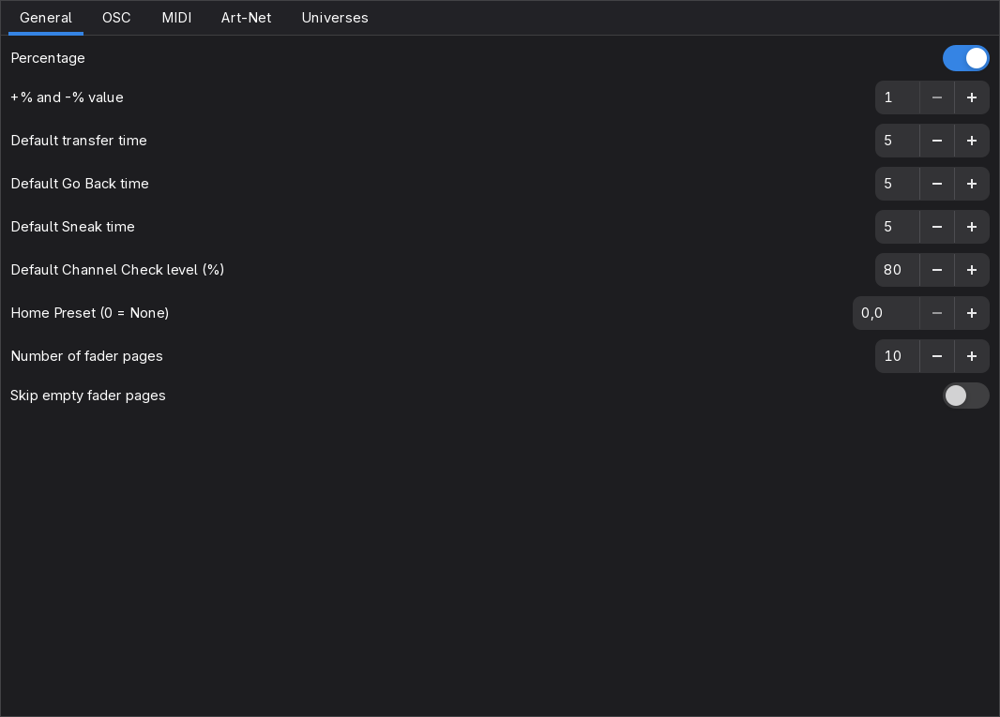
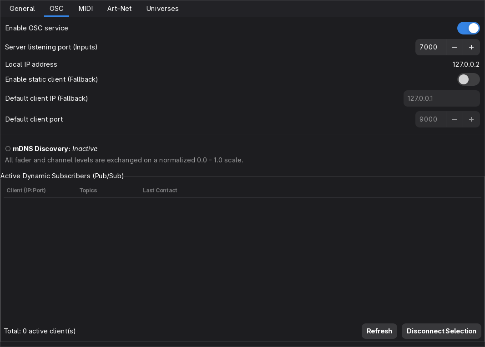
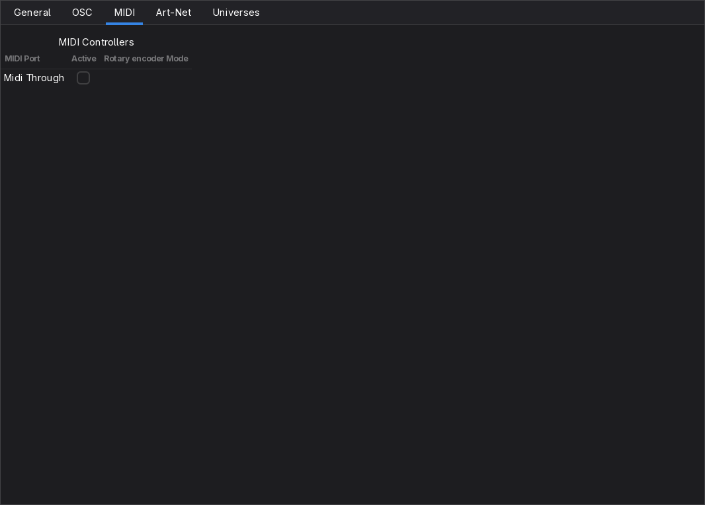
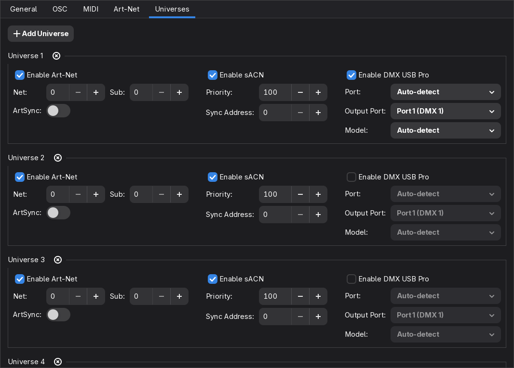

[Français](../doc.fr/settings.md) | [← Table of Contents](index.md)

# 19. Preferences

The **Preferences** tab (opened from the main application menu) is divided into **5 hot-configurable sub-tabs**:

## 1. `General` (Appearance & Behavior)

- **`Percentage`**: switches intensity readouts between percentage (`0..100 %` / `F`) and raw DMX (`0..255`).
- **`+ % and - % value`**: step increment used by `+%` / `-%` (`Ctrl+Up` / `Ctrl+Down`, default `5 %` in schema).
- **`Default transfer time`**: default cue fade duration (`5.0 s`).
- **`Default Go Back time`**: duration of manual `GoBack` transitions (`2.0 s` schema default).
- **`Default Sneak time`**: default `Sneak` release duration (`5.0 s`).
- **`Default Channel Check level (%)`**: intensity applied by `CHECK` when no explicit level is typed (`80 %` default).
- **`Home Preset (0 = None)`**: optional `Preset` number used as the home state (`0.0` for none).
- **`Number of fader pages`**: hot-resizable total count of fader pages.
- **`Skip empty fader pages`**: automatically skips unassigned fader pages on `Page+` / `Page-`.

## 2. `OSC`

Configures the bidirectional OSC server listening port (`7000`), optional fallback static client (`127.0.0.1:9000`), **mDNS / OSCQuery** discovery, and live **Active Dynamic Subscribers (Pub/Sub)** management (`Refresh`, `Disconnect Selection`). See [21. OSC, OSCQuery & TouchOSC](osc.md).

## 3. `MIDI`

Lists available MIDI ports with **`Active`** toggles and per-port **`Rotary encoder Mode`** selection (`Relative 1`, `Relative 2`, `Mackie`, `Absolute`). See [20. MIDI & Mackie Control Surfaces](midi.md).

## 4. `Art-Net`

Discovers local **Art-Net** nodes via *ArtPoll* / *ArtPollReply* and inspects reported node information.

## 5. `Universes` (DMX Outputs)

Click **`+ Add Universe`** to add DMX universes dynamically (click a universe's close icon to remove it):
- **Art-Net**: enable per universe with `Net`, `Sub`, and `ArtSync` controls.
- **sACN (E1.31)**: enable per universe with `Priority` (default `100`) and `Sync Address`.
- **Enttec DMX USB Pro / Mk2**: enable USB DMX interface with **`Auto-detect`** serial port, **`Output Port`** (`Port 1 (DMX 1)`, …), and **`Model`** selection.

---

*Previous: [18. Undo History](history.md) — Next: [20. MIDI & Mackie Control Surfaces →](midi.md)*
