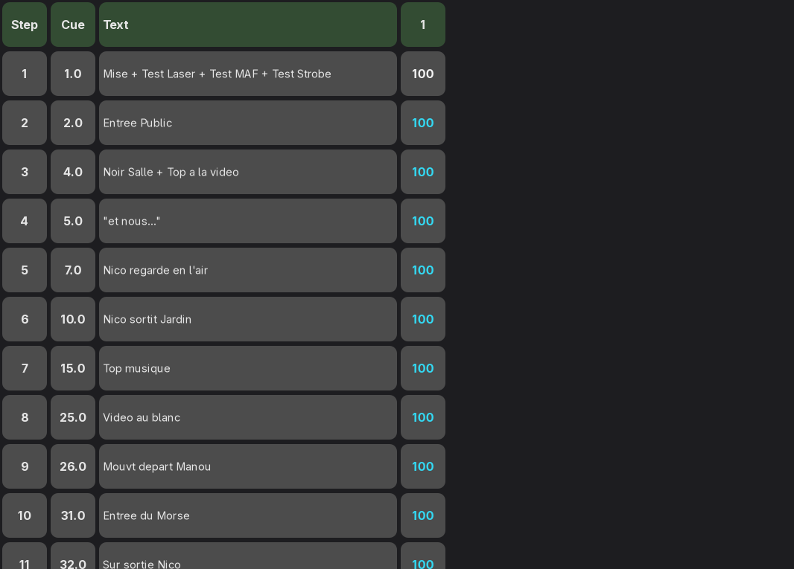

[Français](../doc.fr/track_channels.md) | [← Table of Contents](index.md)

# 15. Track Channels

The **Track Channels** tab (`Shift+Ctrl+T`) shows a step-by-step cue history spreadsheet for one or more selected channels across `Main Playback`:

## Usage

1. Select one or more patched channels in `Channels` (or via CLI, e.g. `1 THRU 4`).
2. Open **`Track Channels`** (`Shift+Ctrl+T`).
3. Rows correspond to sequence steps (`Step`, `Cue`, `Text`) and each additional column tracks one selected channel.

## State Readouts

Levels are rendered using console **tracking colors** (fade up, fade down, tracked/held, blocked) formatted in percent or raw DMX depending on your `Percentage` preference—ideal during technical rehearsals to audit where any fixture turns on, blocks, or fades out.

---

*Previous: [14. Dimmer Curves (Curves)](curves.md) — Next: [16. Independents →](independents.md)*
