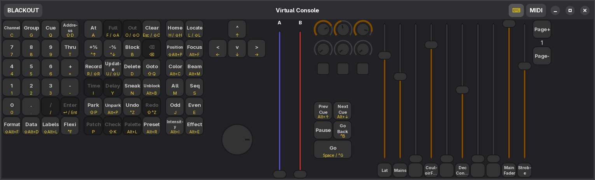

[Français](../doc.fr/virtual_console.md) | [← Table of Contents](index.md)

# 17. Virtual Console

The **Virtual Console** (`Shift+Ctrl+C`) provides a hardware-style control surface window synchronized live with console state, fader banks, OSC, and MIDI:

## Title Bar

- **`BLACKOUT`**: kills all DMX outputs immediately (equivalent to `Shift+Ctrl+B`).
- **Keyboard icon (amber when active)**: pins the keyboard shortcut labels directly on every Virtual Console key (also shown temporarily while holding **`F1`**).
- **`MIDI`**: toggles interactive **MIDI Learn** mode. Click any virtual fader, Flash button, knob, or action button, then move the corresponding hardware control on your MIDI surface to bind it.

## Sections

1. **Numeric & Eos Action Keypad** (left): `Channel`, `Group`, `Cue`, `Address`, `0..9`, `Thru`, `+`, `-`, `/`, `Enter`, quick LiveView controls (`Format`, `Data`, `Labels`, `Flexi`), and full CLI actions (`At`, `Full`, `Out`, `Clear`, `+%`, `-%`, `Block`, `Record`, `Update`, `Delete`, `Goto`, `Time`, `Delay`, `Sneak`, `Unblock`, `Park`, `Unpark`, `Undo`, `Redo`, `Patch`, `Check`, `Palette`, `Preset`, `Home`, `Locate`, `Position`, `Focus`, `Color`, `Beam`, `All`, `Seq`, `Odd`, `Even`, `Intensity`, `Effect`).
2. **Navigation & Manual Playback** (center):
   - Directional cross (`^`, `<`, `v`, `>`) + rotary level wheel.
   - **Dual manual `A` / `B` crossfaders** (blue fade-in, red fade-out).
   - Main playback controls: `Prev Cue`, `Next Cue`, `Pause`, `Go Back`, and **`Go`**.
3. **Independents & Multi-Page Fader Bank** (right):
   - **6 Independent controls** (3 amber-ring rotary encoders + 3 buttons).
   - **10 faders with Flash buttons**, live assigned labels underneath (`Lat`, `Mains`, `Main Fader`, `Strobe`, …), and **`Page+` / `Page-`** buttons around the active page readout.

---

*Previous: [16. Independents](independents.md) — Next: [18. Undo History →](history.md)*
