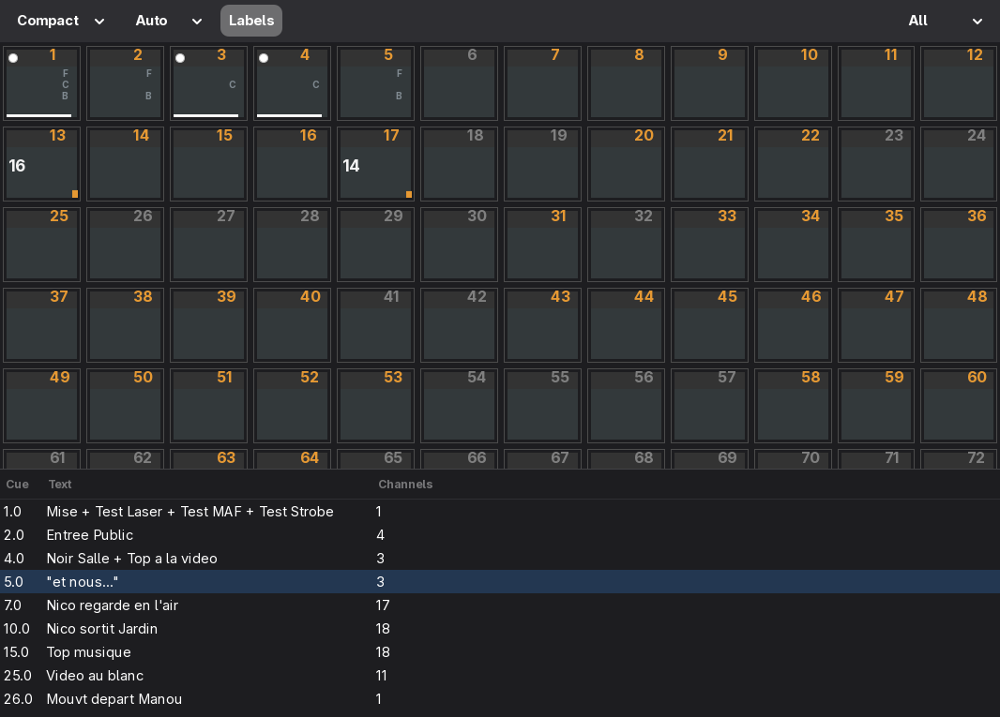

[English](../doc.en/cues.md) | [← Sommaire](index.md)

# 11. Mémoires (`Cues`)

L'onglet **Cues** offre une vue directe sur l'ensemble des mémoires enregistrées et les circuits qu'elles modifient :

## Interface de l'onglet `Cues`

- **Volet supérieur (`ChannelsView`)** : affiche les niveaux des circuits pour la mémoire sélectionnée en bas, avec les contrôles de vue habituels (`Compact` / `Summary+` / `Table`, mode de lecture `Auto / Label / Ref / Percent / DMX`, bouton `Labels` et filtres Flexi).
  - Les circuits contenant des données de palettes/presets ou des attributs IFCB affichent leurs indicateurs `F`, `C`, `B`, leur barre colorée et l'état de progression.
- **Volet inférieur** : tableau des mémoires avec colonnes **`Cue`**, **`Text`** (libellé scénique) et **`Channels`** (nombre de circuits stockés dans la mémoire).

## Création, mise à jour & suppression

- **Via la ligne de commande** :
  - `RECORD 12` ou `RECORD CUE 12 TIME 6` : enregistre l'état courant dans la mémoire `12`.
  - `UPDATE 12` ou `UPDATE` : met à jour la mémoire `12` ou la mémoire active sur scène.
  - `DELETE 12` : supprime la mémoire `12`.
  - `GOTO 12` ou `GOTO CUE 12 TIME 2` : appelle immédiatement la mémoire `12`.
- **Édition directe** : sélectionnez une mémoire dans la liste inférieure pour inspecter, ajuster ou renommer son texte et ses niveaux directement.

---

*Précédent : [10. Effets paramétriques](effects.md) — Suivant : [12. Séquences, Tracking & MIB →](sequences.md)*
