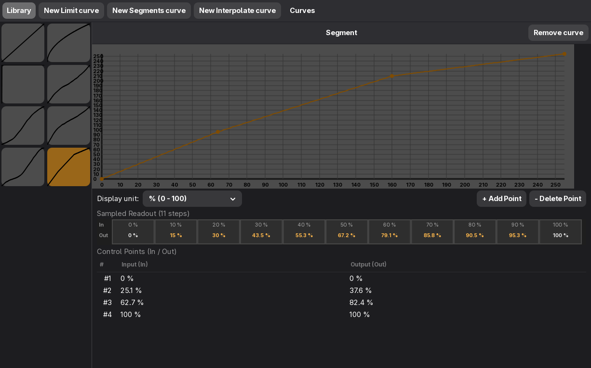

[English](../doc.en/curves.md) | [← Sommaire](index.md)

# 14. Courbes de gradation (`Curves`)

L'onglet **Curves** permet de consulter et créer les lois de réponse liant niveau logique et sortie DMX (`0..255`), assignables ensuite dans l'onglet `Patch` :

## Barre supérieure & Librairie repliable

- **`Library`** : déplie ou replie la grille de miniatures à gauche afin de libérer toute la largeur pour l'édition graphique.
- **`New Limit curve`** : crée une courbe plafonnée (limitation de niveau maximal).
- **`New Segments curve`** : crée une courbe linéaire par morceaux définie par des points d'articulation reliés par des segments droits.
- **`New Interpolate curve`** : crée une courbe lissée par interpolation entre points de contrôle.
- **`Remove curve`** : supprime la courbe personnalisée active.

## Éditeur graphique & Contrôles de précision

- **Graphique interactif (`0..255` en entrée / sortie)** : cliquez-glissez les points directement à la souris (avec curseur `Delete` pour retirer un point sélectionné).
- **`Display unit`** : bascule l'affichage numérique entre **`% (0 - 100)`** et **`DMX (0 - 255)`**.
- **`+ Add Point` / `- Delete Point`** : ajoute ou supprime un point de contrôle.
- **`Sampled Readout (11 steps)`** : tableau de lecture rapide des valeurs de sortie correspondantes pour chaque pas de `10 %` (`0 %` à `100 %`).
- **`Control Points (In / Out)`** : liste éditable de chaque couple exact entrée/sortie (`#1`, `#2`, …).

---

*Précédent : [13. Faders multi-pages](faders.md) — Suivant : [15. Suivi des circuits (Track Channels) →](track_channels.md)*
