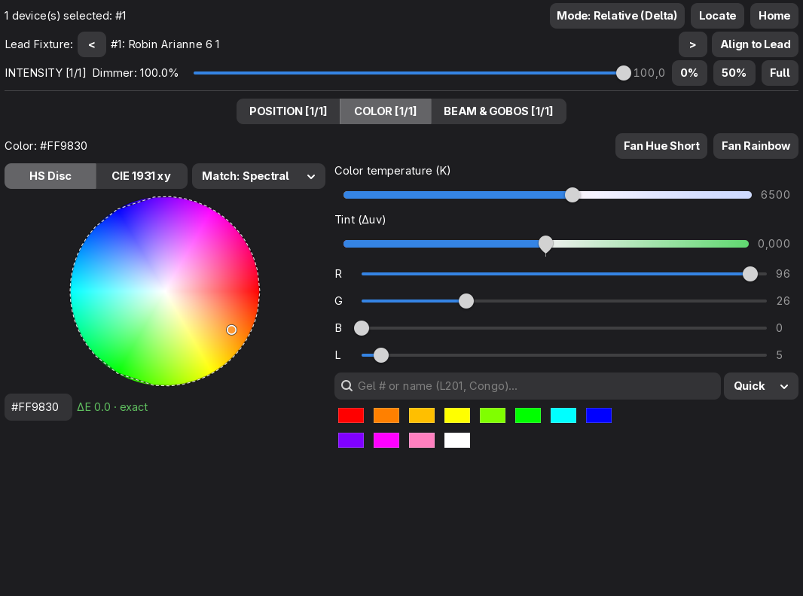

[English](../doc.en/device_inspector.md) | [← Sommaire](index.md)

# 7. Inspecteur de projecteurs (`Device Inspector`)

L'onglet **Device Inspector** (`Shift+Ctrl+I`) fournit l'interface complète de pilotage IFCB (*Intensity, Focus/Position, Color, Beam*) pour tout circuit multi-paramètres sélectionné :

## En-tête de sélection & intensité commune

- **Sélection multiple & `Lead Fixture`** : affiche le nombre de projecteurs sélectionnés ; les boutons `<` et `>` font défiler le projecteur maître (*Lead Fixture*).
- **`Align to Lead`** : aligne les paramètres de toute la sélection sur le projecteur maître.
- **`Mode: Relative (Delta)`** / absolu : bascule entre décalage relatif et valeur commune lors de l'édition multi-projecteurs.
- **`Locate`** et **`Home`** : placent les appareils en repérage rapide ou ramènent leurs paramètres aux valeurs *Home*.
- **Curseur `INTENSITY` + raccourcis `0%`, `50%`, `Full`** : contrôle immédiat du gradateur ou du dimmer virtuel.

## Famille `POSITION`

- **Pavé XY (`Pan/Tilt`)** interactif avec retour temps réel de la position.
- **Encodeurs rotatifs `Pan` et `Tilt` 16 bits** haute précision (`Fine 16-bit (0.05°)`), avec boutons **Center**, **Invert** et répartition **Fan** sur plusieurs projecteurs.

## Famille `COLOR` (Sélecteur N-LED & Colorimétrie scientifique)

Le sélecteur couleur unifie tous les types de synthèses additives (RGB, RGBA, RGBW, RGBL/RGBAL, RGBAW, CMY) via un solveur **NNLS** :

- **Vues `HS Disc` / `CIE 1931 xy`** : choix direct sur la roue teinte/saturation ou sur le diagramme chromatique CIE 1931 avec affichage du gamut physique du projecteur.
- **Stratégie de conversion (`Match: Spectral`, etc.)** et affichage du code hexadécimal et de l'écart colorimétrique (**$\Delta E$**).
- **Température de couleur (`Color temperature (K)`)** et décalage vert/magenta **`Tint (Δuv)`**.
- **Faders individuels par émetteur** (`R`, `G`, `B`, `L`, `W`, `A`, …).
- **Fan couleur** : **`Fan Hue Short`** et **`Fan Rainbow`** pour répartir un dégradé sur une sélection de plusieurs projecteurs.
- **Recherche de gélatines (`Lee`, `Rosco`)** : champ de recherche instantanée par numéro ou nom (ex. `L201`, `Congo`) et accès rapide aux pastilles favorites.

## Famille `BEAM & GOBOS`

Regroupe tous les contrôles optiques disponibles sur le profil : **`Zoom`**, **`Focus`**, **`Iris`**, **`Strobe`**, **`Frost`**, sélecteur et indexation **`Gobo`** ainsi que **`Prism`**.

---

*Précédent : [6. Bibliothèque de projecteurs & GDTF](fixtures.md) — Suivant : [8. Palettes & Presets →](palettes.md)*
