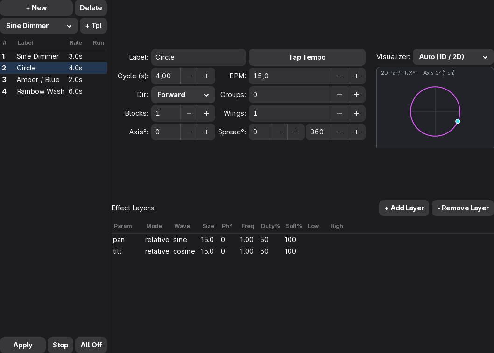

[English](../doc.en/effects.md) | [← Sommaire](index.md)

# 10. Effets paramétriques (`Effects`)

Open Lighting Console remplace les anciens chenillards statiques par un **moteur d'effets paramétriques** temps réel calculés à 44 Hz en virgule flottante (`Shift+Ctrl+E` ou `Alt+E`) :

## Bibliothèque & Modèles intégrés (`+ Tpl`)

La colonne de gauche liste les effets du spectacle (`#`, `Label`, `Rate`, `Run`). Le bouton **`+ New`** crée un effet vierge, **`Delete`** le supprime, et **`+ Tpl`** génère directement l'un des **10 modèles intégrés** :

| Modèle intégré | Effet produit |
| -------------- | ------------- |
| `sine_dimmer` | Ondulation sinusoïdale d'intensité |
| `chase_cancan` | Chenillard d'intensité pas à pas |
| `candle_flicker` | Scintillement organique type bougie |
| `circle` | Mouvement circulaire 2D `Pan` / `Tilt` (onde sinus + cosinus) |
| `figure_8` | Trajectoire en 8 (`Lissajous` 1:2) sur `Pan` / `Tilt` |
| `tilt_wave` | Vague verticale sur `Tilt` |
| `fly_in_out` | Balayage synchronisé intensité + `Tilt` |
| `two_color_chase` | Alternance entre deux couleurs |
| `rainbow` | Balayage continu du spectre de teintes (`Hue` / émetteurs RGB) |
| `zoom_pulse` | Pulsation périodique du paramètre `Zoom` |

En bas de la liste, **`Apply`**, **`Stop`** et **`All Off`** déclenchent l'effet sur la sélection active, l'arrêtent ou coupent tous les effets en cours.

## Propriétés temporelles & répartition spatiale

- **`Label`** : nom libre de l'effet.
- **`Tap Tempo`** : définit la cadence en rythme au clic sur le bouton.
- **`Cycle (s)`** et **`BPM`** : durée d'un cycle complet en secondes ou vitesse en battements par minute (liés dynamiquement).
- **`Dir`** : sens de parcours (`Forward`, …).
- **`Groups`**, **`Blocks`**, **`Wings`** : regroupement de circuits adjacents, blocs synchrones et symétrie en miroir (*ailes*).
- **`Axis°`** et **`Spread°`** : angle d'orientation 2D (pour les effets XY) et plage de déphasage totale répartie entre les projecteurs (ex. `0°` à `360°`).

## Prévisualisation temps réel (`Visualizer`) & Couches (`Effect Layers`)

- **`Visualizer`** : bascule entre **`Auto (1D / 2D)`** (affiche un tracé **Cairo 2D XY** pour `Pan`/`Tilt` comme sur la capture, ou une courbe d'onde) et **`1D Waveform`** (courbes temporelles de chaque couche).
- **Tableau `Effect Layers`** (`+ Add Layer`, `- Remove Layer`) : chaque effet empile une ou plusieurs couches éditables directement :
  - `Param` (`intensity`, `pan`, `tilt`, `color`, `zoom`, …)
  - `Mode` (`relative`, `absolute`, …)
  - `Wave` (`sine`, `cosine`, `triangle`, `square`, …)
  - `Size`, `Ph°` (déphasage initial), `Freq` (multiplicateur de fréquence), `Duty%`, `Soft%`, `Low`, `High`.

## Restitution dans les cues, faders et CLI

- **CLI** : `<sélection> EFFECT 2` démarre l'effet `2` ; `STOP EFFECT 2` ou `STOP` l'arrête.
- **Séquences & Tracking** : les effets lancés ou arrêtés en Live s'enregistrent dans les cues et se suivent en mode `Tracking` (colonne `FX` dans l'onglet `Sequences`).
- **Faders** : un fader de type **`Effect`** permet de contrôler en direct **`Mode: Size`**, **`Mode: Rate`** ou **`Mode: Size+Rate`**.

---

*Précédent : [9. Groupes](groups.md) — Suivant : [11. Mémoires (Cues) →](cues.md)*
