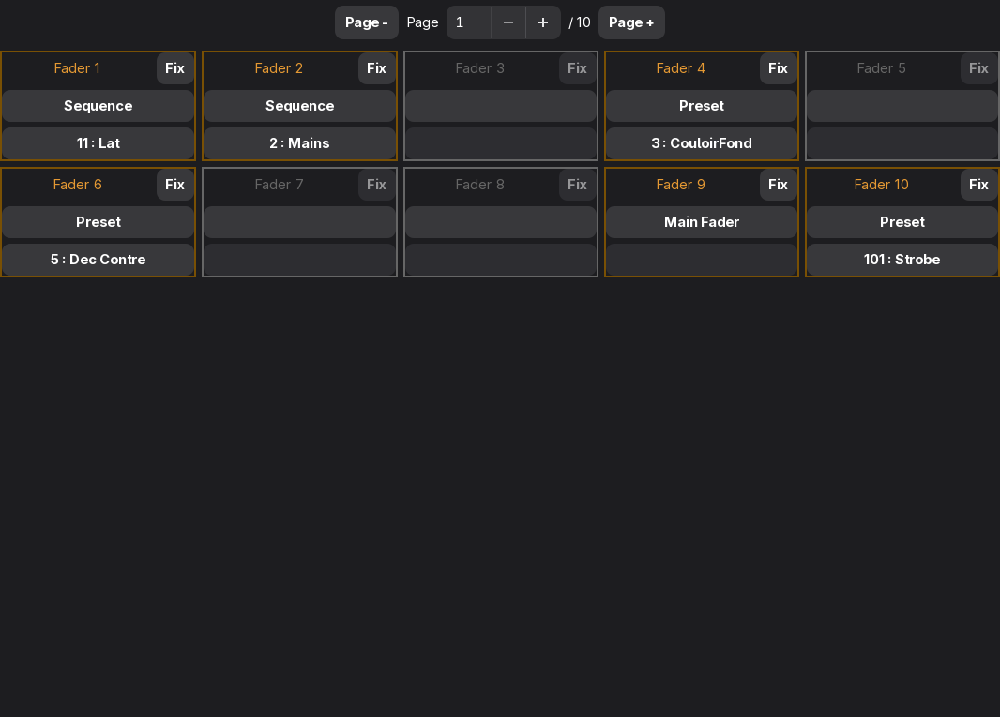

[English](../doc.en/faders.md) | [← Sommaire](index.md)

# 13. Faders multi-pages (`Faders`)

L'onglet **Faders** (`Shift+Ctrl+F`) permet de configurer les banques de **10 faders par page** affichées dans la Console Virtuelle, synchronisées en MIDI et en OSC :

## Navigation multi-pages

La barre supérieure commande le changement de page (le nombre total de pages et l'option *Skip empty fader pages* se règlent dans **Preferences → General**) :

- **`Page -` / `Page +`** : passe à la page précédente ou suivante.
- **Sélecteur numérique `Page <n> / <total>`** : accès direct à n'importe quelle page.

## Affectation d'un fader

Chaque emplacement affiche un bloc de configuration comprenant :

- **En-tête `Fader <N>` + bouton bascule `Fix`** : lorsque **`Fix`** est activé, l'affectation de ce fader reste **épinglée à l'identique à travers toutes les pages** (pratique pour garder le `Main Fader`, une façade ou un effet général toujours accessible).
- **Bouton Type** : choisit le rôle du fader :
  - *(vide)* : emplacement non assigné.
  - **`Preset`** : restitue un `Preset` enregistré (intensité HTP + paramètres).
  - **`Sequence`** : affecte une séquence auxiliaire (par exemple `2 : Mains`, `11 : Lat`).
  - **`Effect`** : pilote un effet paramétrique en direct, avec choix de mode (**`Mode: Size`**, **`Mode: Rate`** ou **`Mode: Size+Rate`**) et portée de circuits.
  - **`Main Fader`** : sert de général maître sur l'ensemble de la sortie.
- **Bouton Contenu** : sélectionne l'élément cible (numéro et nom du `Preset`, de la `Sequence` ou de l'`Effect`).

---

*Précédent : [12. Séquences, Tracking & MIB](sequences.md) — Suivant : [14. Courbes de gradation (Curves) →](curves.md)*
