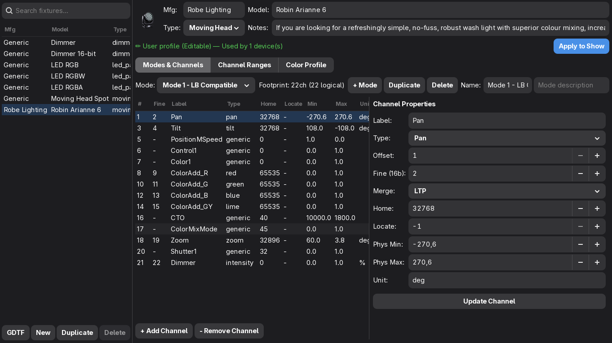

[English](../doc.en/fixtures.md) | [← Sommaire](index.md)

# 6. Bibliothèque de projecteurs & GDTF (`Fixtures`)

L'onglet **Fixtures** (`Shift+Ctrl+P`) donne accès au catalogue complet des projecteurs intégrés, utilisateur et importés via GDTF :

## Catalogue de gauche

- **Barre de recherche (`Search fixtures...`)** : filtre en direct par fabricant (`Mfg`), modèle (`Model`) ou type (`Type`).
- **Colonnes** : `Mfg`, `Model`, `Type`, `Used` (nombre d'appareils actifs dans le spectacle).
- **Boutons de gestion** :
  - **`GDTF`** : importe un fichier constructeur `.gdtf` (**DIN SPEC 15800**) grâce à la bibliothèque `pygdtf` (canaux 8/16 bits, modes multiples, plages fonctionnelles et primaires colorimétriques).
  - **`New`** : crée un profil de projecteur vierge éditable par l'utilisateur.
  - **`Duplicate`** : duplique n'importe quel profil intégré pour l'adapter librement.
  - **`Delete`** : supprime un profil utilisateur.

## Éditeur de droite

Un profil utilisateur (indiqué par `User profile (Editable)`) ou fraîchement importé peut être modifié à chaud :

- **Métadonnées** : `Mfg`, `Model`, `Type` (`Moving Head`, `dimmer`, `led_par`, …), `Notes`.
- **`Apply to Show`** : propage immédiatement les modifications du profil aux projecteurs déjà patchés dans le spectacle sans devoir repatcher.
- **Sous-onglet `Modes & Channels`** :
  - Sélectionnez ou créez des modes (`Mode`, `+ Mode`, `Duplicate`, `Delete`, `Name`, `Mode description`) avec calcul automatique du `Footprint` (canaux physiques et logiques).
  - Liste des canaux (`#`, `Fine`, `Label`, `Type`, `Home`, `Locate`, `Min`, `Max`, `Unit`) avec `+ Add Channel` et `- Remove Channel`.
  - Panneau latéral **`Channel Properties`** : édition précise de `Label`, `Type`, `Offset`, `Fine (16b)`, `Merge` (`LTP` / `HTP`), valeurs `Home` / `Locate`, `Phys Min` / `Phys Max`, `Unit` et validation par **`Update Channel`**.
- **Sous-onglet `Channel Ranges`** : définit les plages discrètes d'un canal (roues de gobos, roues de couleurs, fonctions shutter/contrôle) pour que l'inspecteur affiche noms et vignettes significatifs.
- **Sous-onglet `Color Profile`** : configure les primaires spectrales/CIE et les points blancs des émetteurs multi-LED afin d'alimenter le solveur colorimétrique du `Device Inspector`.

---

*Précédent : [5. Patch & Sorties DMX](patch.md) — Suivant : [7. Inspecteur de projecteurs (Device Inspector) →](device_inspector.md)*
