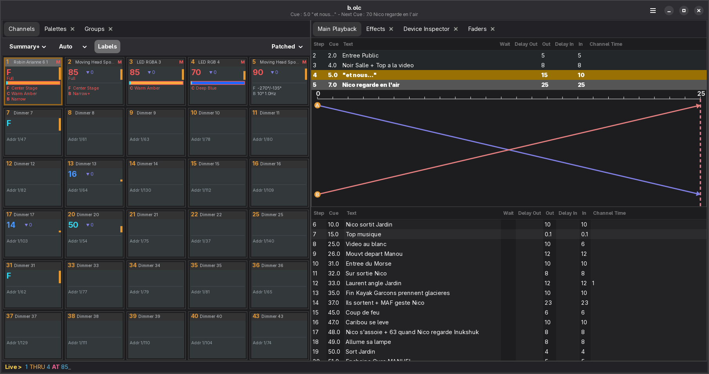
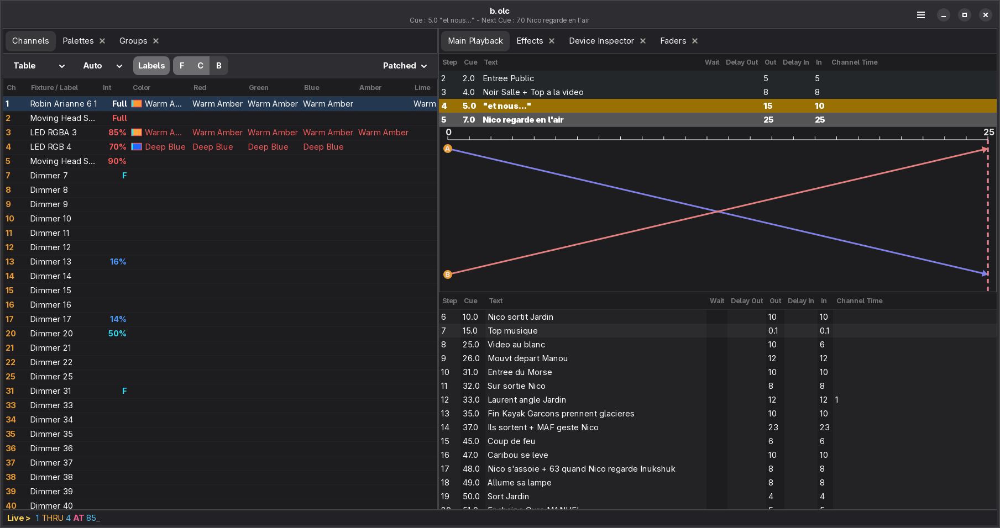

[English](../doc.en/general.md) | [← Sommaire](index.md)

# 2. Fenêtre principale & Vues Direct (`LiveView`)

## Disposition générale

La fenêtre principale d'Open Lighting Console s'organise autour d'une barre d'en-tête, de deux volets redimensionnables côte à côte (séparés par un séparateur vertical) et d'une barre de ligne de commande pleine largeur en bas de fenêtre :

- **Barre d'en-tête (`HeaderBar`)** : affiche le nom du fichier courant (ex. `b.olc`), le sous-titre en temps réel (`Cue : 5.0 "..." - Next Cue : 7.0 ...`), le bouton du menu principal et les contrôles de fenêtre.
- **Volet gauche (`LiveView`)** : consacré aux **Circuits (`Channels`)** et aux onglets qu'on choisit d'y déplacer.
- **Volet droit (`Playback`)** : regroupe la restitution principale (**`Main Playback`**) — liste précédente au-dessus, graphique de transfert **A/B Crossfade** au centre, liste suivante en dessous — ainsi que les autres éditeurs ouverts sous forme d'onglets.
- **Ligne de commande (en bas)** : affiche le préfixe contextuel (`Live >`), les jetons colorés par catégorie syntaxique et les suggestions d'auto-complétion.

## Gestion des onglets

Tous les outils accessibles depuis le menu principal (`Patch`, `Fixtures`, `DMX Outputs`, `Curves`, `Cues`, `Groups`, `Palettes`, `Effects`, `Sequences`, `Faders`, `Track Channels`, `Independents`, `Device Inspector`, `History`, `Preferences`) s'ouvrent sous forme d'onglets :

- **`Shift+Tab`** : déplace l'onglet actif entre le volet gauche et le volet droit afin d'afficher simultanément deux outils complémentaires (par exemple `Channels` à gauche et `Effects` ou `Device Inspector` à droite, ou encore `Palettes` à gauche et `Main Playback` à droite).
- **`Ctrl+W`** : ferme l'onglet courant (hors `Channels` et `Main Playback`, qui restent permanents).
- La disposition ouverte (onglets, volet d'accueil, position du séparateur) est mémorisée dans le fichier `.olc`.

## Modes de vue Direct (`LiveView`)

La barre d'outils de l'onglet **Channels** contrôle la présentation des circuits :

### 1. Format d'affichage (`Shift+Alt+F`)
- **Compact** : grille dense de tuiles affichant numéro, niveau d'intensité, barre d'intensité et indicateurs `F` / `C` / `B` + pastille couleur.
- **Summary+** : tuiles enrichies affichant sur chaque circuit multi-paramètres le nom du projecteur, la barre couleur, et le résumé textuel (étiquettes de palettes `IP`/`FP`/`CP`/`BP` ou valeurs brutes Pan/Tilt/Zoom/Strobe).
- **Table** : tableau structuré ligne par ligne avec filtrage dépliable par famille (`F` Focus, `C` Color, `B` Beam), colonnes dynamiques pour chaque paramètre réel des projecteurs patchés et échantillon RVB intégré.

### 2. Mode de lecture (`Shift+Alt+D`)
Bascule les données affichées dans les paramètres non-intensité et les tuiles :
- **Auto** : privilégie le nom de la palette/preset référencé s'il existe, sinon la valeur physique/formatée.
- **Label** : affiche les étiquettes des projecteurs/palettes.
- **Ref** : affiche les identifiants de référence (`IP1`, `FP1`, `CP1`, `BP1`, `PR1`).
- **Percent** : force l'affichage en pourcentage (`0..100` / `F`).
- **DMX** : force l'affichage brut DMX (`0..255` / `0..65535`).

### 3. Étiquettes & Filtres Flexi
- **Bouton `Labels` (`Shift+Alt+L`)** : affiche ou masque les noms personnalisés des projecteurs et circuits.
- **Filtre Flexi (`Ctrl+F`)** : fait défiler les filtres d'affichage des circuits :
  - **All** : tous les circuits jusqu'à `MAX_CHANNELS`.
  - **Patched** : uniquement les circuits patchés.
  - **Active** : uniquement les circuits dont l'intensité est supérieure à 0 ou en transition.
  - **Devices** : uniquement les projecteurs multi-paramètres.
  - **Selected** : uniquement la sélection courante.
  - **Manual** : uniquement les circuits modifiés en manuel par l'opérateur.

## Raccourcis clavier généraux et navigation

| Raccourci | Action |
| --------- | ------ |
| `Ctrl+O` / `Ctrl+S` / `Shift+Ctrl+S` | Ouvrir / Enregistrer / Enregistrer sous |
| `Shift+Ctrl+O` | Importer un fichier USITT ASCII |
| `Ctrl+Z` / `Shift+Ctrl+Z` (`Ctrl+Y`) | Annuler / Rétablir |
| `Ctrl+W` / `Shift+Tab` | Fermer l'onglet actif / Déplacer l'onglet vers l'autre volet |
| `F11` / `F3` / `Ctrl+Q` | Plein écran / À propos / Quitter |
| `Ctrl+F` | Changer de filtre Flexi (`All`, `Patched`, `Active`, `Devices`, `Selected`, `Manual`) |
| `Shift+Alt+F` / `Shift+Alt+D` / `Shift+Alt+L` | Changer de Format (`Compact`/`Summary+`/`Table`) / Mode de lecture / Étiquettes |
| `Shift+Ctrl+B` | **Blackout** général (DBO) |
| `Ctrl+A` / `Ctrl+Haut` / `Ctrl+Bas` | Sélectionner tous les circuits actifs / Niveau `+ %` / `- %` |
| `Espace` ou `Ctrl+G` / `Ctrl+B` / `Ctrl+Espace` | **Go** / **GoBack** / **Pause** sur `Main Playback` |
| `Alt+Bas` / `Alt+Haut` | Étape/Cue/Groupe/Palette suivant(e) ou précédent(e) |
| `Shift+Haut` / `Shift+Bas` | Historique précédent / suivant de la ligne de commande |
| `Flèches`, `PageUp`, `PageDown` | Naviguer dans la grille de circuits |
| `F2` / `Insert` / `Delete` | Renommer / Insérer une mémoire ou un Channel Time / Supprimer l'élément sélectionné |

### Raccourcis directs d'ouverture des onglets

| Raccourci | Onglet |
| --------- | ------ |
| `Ctrl+P` / `Shift+Ctrl+P` / `Ctrl+D` | `Patch` / `Fixtures` / `DMX Outputs` |
| `Shift+Ctrl+G` / `Shift+Ctrl+L` / `Shift+Ctrl+E` | `Groups` / `Palettes` / `Effects` |
| `Ctrl+T` / `Shift+Ctrl+T` | `Sequences` / `Track Channels` |
| `Ctrl+F` *(Flexi)* / `Shift+Ctrl+F` / `Ctrl+I` | Filtre Flexi / `Faders` / `Independents` |
| `Shift+Ctrl+I` / `Shift+Ctrl+C` / `Shift+Ctrl+H` | `Device Inspector` / `Virtual Console` / `Undo History` |

---

*Précédent : [1. Introduction](intro.md) — Suivant : [3. Ligne de commande (CLI) →](commandline.md)*
