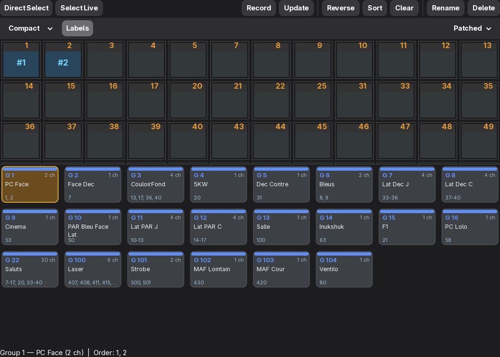

[English](../doc.en/groups.md) | [← Sommaire](index.md)

# 9. Groupes

L'onglet **Groups** (`Shift+Ctrl+G`) sert à enregistrer et rappeler des **sélections ordonnées de circuits** (sans niveaux d'intensité stockés) afin d'accélérer le pointage, l'édition en Live et la répartition spatiale des effets :

## Aperçu visuel & Ordre de sélection

- La partie supérieure affiche une grille `ChannelsView` avec barre d'outils (`Compact` / `Summary+`, `Labels`, filtre `Patched`, …).
- **Badges d'ordre (`#1`, `#2`, …)** : les circuits appartenant au groupe sélectionné portent un badge indiquant leur rang exact dans l'ordre du groupe (utile pour les chenillards, les éventails `Fan` et le paramètre `Phase` / `Spread` des effets).
- La partie inférieure présente les tuiles des groupes (`G 1 — PC Face — 2 ch — 1, 2`) ainsi qu'une ligne d'état résumant le nom, le nombre de circuits et la liste ordonnée (`Order: 1, 2`).

## Outils de la barre supérieure

- **`Direct Select`** : en mode actif, cliquer sur une tuile sélectionne immédiatement les circuits du groupe dans `LiveView`.
- **`Select Live`** : envoie la sélection du groupe courant vers la vue `Channels` principale.
- **`Record`** / **`Update`** : enregistre la sélection active dans un nouveau groupe ou remplace le contenu du groupe courant.
- **`Reverse`** : inverse l'ordre des circuits du groupe sélectionné (ex. `1, 2, 3, 4` devient `4, 3, 2, 1`).
- **`Sort`** : trie ou réordonne la sélection selon l'ordre croissant ou l'ordre courant saisi.
- **`Clear`** : désélectionne tous les circuits de l'éditeur.
- **`Rename`** (`F2`) / **`Delete`** (`Delete`) : renomme ou supprime le groupe sélectionné.

## Commandes CLI équivalentes

- Sélectionner un groupe : `GROUP 1` ou `G 1 THRU 3`
- Enregistrer / Nommer : `RECORD GROUP 10 LABEL "Faces"`
- Mettre à jour / Renommer / Supprimer : `UPDATE GROUP 10`, `LABEL GROUP 10 "Contres"`, `DELETE GROUP 10`

---

*Précédent : [8. Palettes & Presets](palettes.md) — Suivant : [10. Effets paramétriques →](effects.md)*
