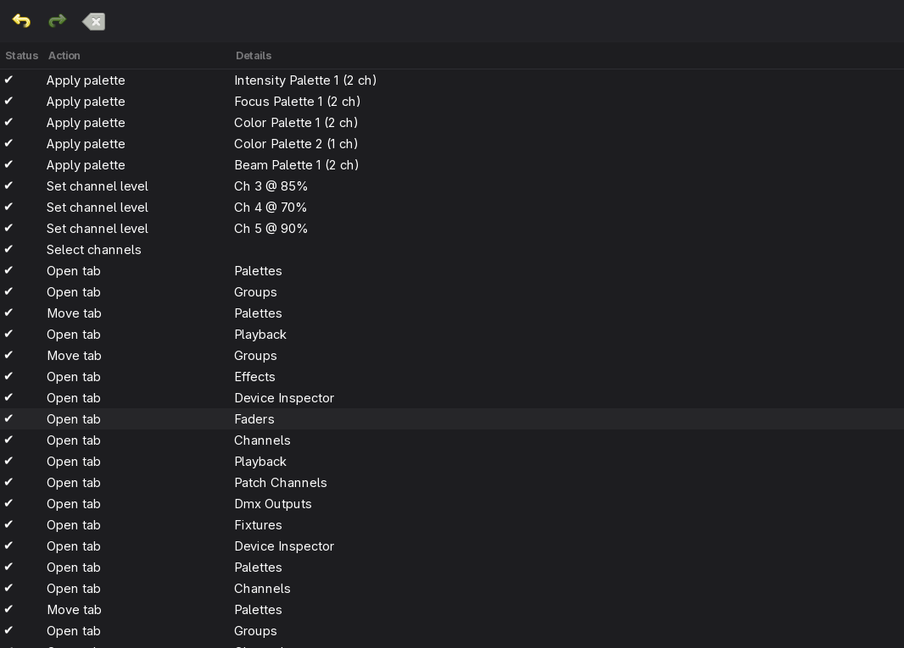

[English](../doc.en/history.md) | [← Sommaire](index.md)

# 18. Historique (`Undo History`)

L'onglet **Undo History** (`Shift+Ctrl+H`) affiche la pile chronologique complète des opérations annulables et rétablissables :

## Utilisation

- **Barre supérieure** :
  - **Annuler (`Ctrl+Z`)** : revient à l'état antérieur à l'action sélectionnée.
  - **Rétablir (`Shift+Ctrl+Z` / `Ctrl+Y`)** : réapplique les actions annulées.
  - **Vider l'historique** : libère la pile courante d'annulation.
- **Tableau lisible** : affiche pour chaque entrée le statut (**`✓`** appliquée), le nom descriptif de l'action (`Apply palette`, `Set channel level`, `Select channels`, `Open tab`, `Move tab`, …) et ses détails exacts (`Intensity Palette 1 (2 ch)`, `Ch 3 @ 85%`, …).

---

*Précédent : [17. Console virtuelle (Virtual Console)](virtual_console.md) — Suivant : [19. Préférences (Preferences) →](settings.md)*
