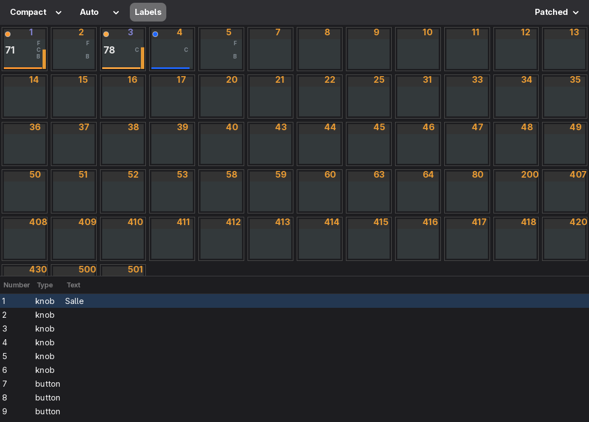

[English](../doc.en/independents.md) | [← Sommaire](index.md)

# 16. Indépendants (`Independents`)

L'onglet **Independents** (`Ctrl+I`) gère **6 canaux auxiliaires permanents** dont le niveau est indépendant de la restitution séquentielle (`Main Playback`) et du `Main Fader` — typiquement utilisés pour l'éclairage de salle, les machines à brouillard/ventilation ou des services de plateau :

## Configuration d'un Indépendant

- **Volet inférieur** : tableau des numéros (`1` à `6`) avec colonne **`Type`** sélectionnable entre **`knob`** (rotatif proportionnel `0..100 %`, affiché sur les 3 potentiomètres supérieurs à jauge ambrée dans la Console Virtuelle) et **`button`** (bascule tout-ou-rien associée aux boutons inférieurs) et colonne **`Text`** éditable directement (ou via `F2`, ex. `Salle`).
- **Volet supérieur (`ChannelsView`)** : sélectionnez un indépendant dans la liste, ajustez les niveaux des circuits concernés puis enregistrez la modification sur cet indépendant (touche `U`).

## Pilotage en direct

- **Console Virtuelle** : les 3 premiers indépendants de type `knob` apparaissent sur la rangée supérieure des rotatifs, et les boutons au-dessous.
- **Ligne de commande** : `INDEPENDENT <n> AT <niveau>`.
- **OSC** : routes `/olc/independent/<n>/level`, `/olc/independent/<n>/button` et `/olc/independent/dump`.

---

*Précédent : [15. Suivi des circuits (Track Channels)](track_channels.md) — Suivant : [17. Console virtuelle (Virtual Console) →](virtual_console.md)*
