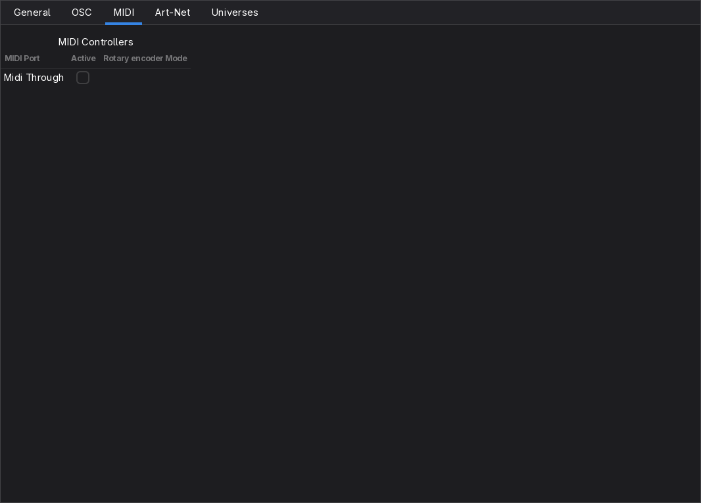

[English](../doc.en/midi.md) | [← Sommaire](index.md)

# 20. MIDI & Surfaces Mackie Control

Open Lighting Console prend en charge les contrôleurs **MIDI** génériques ainsi que les surfaces de contrôle motorisées compatibles **Mackie Control Universal (MCU)** via `mido` et `python-rtmidi`.

## Activation & Modes d'encodeurs rotatifs

Dans **Preferences → MIDI** :
1. Cochez **`Active`** sur le ou les ports MIDI de votre contrôleur (l'exemple `Midi Through` apparaît même sans matériel branché).
2. Choisissez dans **`Rotary encoder Mode`** le protocole émis par vos encodeurs rotatifs infinis :
   - **`Relative 1`** *(Complément à 2)* : valeurs `1..63` pour incrémenter, `65..127` pour décrémenter.
   - **`Relative 2`** *(Bit de signe)* : valeurs `1..63` dans un sens, `65..127` dans l'autre selon convention *Sign Bit / Offset*.
   - **`Mackie`** : format relatif des encodeurs *V-Pot* Mackie Control.
   - **`Absolute`** : potentiomètres physiques classiques `0..127`.

## Apprentissage MIDI (*MIDI Learn*)

L'association ne nécessite aucun fichier de configuration manuel :
1. Ouvrez la **Console virtuelle** (`Shift+Ctrl+C`).
2. Activez le bouton **`MIDI`** dans la barre de titre.
3. Cliquez sur le contrôle souhaité (fader, bouton Flash, encodeur ou bouton indépendant, touche `Go`, `Pause`, `Go Back`, …).
4. Bougez le curseur, le bouton ou le potentiomètre physique correspondant sur votre surface MIDI : l'affectation est mémorisée par page/contrôle et sauvegardée dans le fichier `.olc`.

## Retour moteur, LED & Écran `MackieLCD`

Lorsque le contrôleur prend en charge le retour bidirectionnel :
- **Faders & Flashs** : les changements de page, les rappels de mémoires et l'interface graphique renvoient les messages *Control Change* et *Note* pour repositionner les faders motorisés et allumer les témoins LED.
- **Écran LCD Mackie (`MackieLCD`)** : affiche automatiquement les étiquettes des faders assignés sur l'afficheur SysEx des surfaces MCU compatibles.

---

*Précédent : [19. Préférences (Preferences)](settings.md) — Suivant : [21. OSC, OSCQuery & TouchOSC →](osc.md)*
