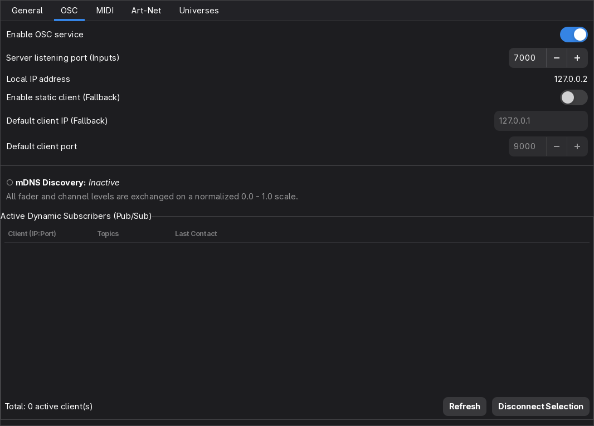

[English](../doc.en/osc.md) | [← Sommaire](index.md)

# 21. OSC, OSCQuery & TouchOSC

Open Lighting Console embarque un serveur **OSC (`asyncio`)** complet avec découverte réseau **mDNS**, arbre **OSCQuery**, abonnement dynamique **Pub/Sub** et modèles **TouchOSC** prêts à l'emploi.

## Configuration réseau & Découverte

- **Port d'écoute serveur** : `7000` par défaut (`Server listening port`).
- **Client statique de repli (optionnel)** : `127.0.0.1:9000` (`Enable static client (Fallback)`).
- **Échelle normalisée** : tous les niveaux de faders et de circuits sont échangés en virgule flottante **`0.0 .. 1.0`**.
- **Découverte mDNS & OSCQuery** : expose automatiquement l'arborescence des adresses OSC (utilisant `zeroconf` si installé, ou le répondeur mDNS Python intégré en secours).
- **Abonnement dynamique (Pub/Sub)** : envoyez `/olc/channels/subscribe` ou `/olc/subscribe/status` pour recevoir en push les mises à jour de la console ; les clients abonnés s'affichent en direct dans `Active Dynamic Subscribers` et peuvent être déconnectés individuellement.

## Templates TouchOSC fournis

Deux modèles adaptés sont fournis dans `data/templates/touchosc/` :
- `OpenLightingConsole_Tablet.tosc` (tablettes)
- `OpenLightingConsole_Phone.tosc` (téléphones)

Ils peuvent être régénérés à tout moment via `tools/generate_touchosc_templates.py`.

---

## Référence des routes OSC (`/olc/*`)

### Circuits, Grille `LiveView`, Park, Sneak & DMX brut
- **Abonnement & Grille** : `/olc/channels/subscribe`, `/olc/subscribe/status`, `/olc/channels/page/+`, `/olc/channels/page/-`, `/olc/channels/start`, `/olc/channels/dump`, `/olc/channels/format`, `/olc/channels/data`, `/olc/channels/readout`, `/olc/channels/labels`, `/olc/channels/labels/toggle`, `/olc/channels/flexi`
- **Cellules & Circuits** : `/olc/cell/*/touch`, `/olc/cell/*/level`, `/olc/channel/*/touch`, `/olc/channel/*/level`
- **Park & Sneak** : `/olc/channel/*/park`, `/olc/channel/*/unpark`, `/olc/address/*/*/park`, `/olc/address/*/*/unpark`, `/olc/park/unpark_all`, `/olc/channels/sneak`, `/olc/channel/*/sneak`
- **Injection DMX brute par univers** : `/olc/universe/*/set_channels`, `/olc/universe/*/blackout`

### Projecteurs sélectionnés, Encodeurs & Paramètres individuels
- **Encodeurs relatifs (`wheel`)** : `/olc/wheel/{intensity,pan,tilt,zoom,focus,iris,strobe,frost,gobo,prism,cct,kelvin}`, `/olc/wheel/param/*`
- **Sélection active (`selected`)** : `/olc/selected/{intensity,pan,pan/norm,tilt,tilt/norm,color/rgb,color/r,color/g,color/b,color/hue,color/sat,color/hsv,zoom,zoom/degrees,focus,focus/meters,iris,strobe,strobe/hz,frost,gobo,prism,color/kelvin,cct,home,locate}`, `/olc/selected/param/*`
- **Projecteur cible (`device/<id>`)** : `/olc/device/*/{zoom,focus,iris,strobe,frost,gobo,prism,pan,tilt,color/rgb,home,locate}`, `/olc/device/*/param/*`

### Restitution, Faders, Indépendants & Console
- **Séquences & Crossfade** : `/olc/key/{go,pause,goback,seq+,seq-}`, `/olc/playback/{goto_cue,goto,active/cue,next/cue,state,dump,xfade/a,xfade/b,xfade}`, `/olc/cue/dump`
- **Général & Sync** : `/olc/mainfader`, `/olc/blackout`, `/olc/sync`
- **Faders** : `/olc/fader/{pageupdate,page,page+,page-}`, `/olc/fader/1/*/level`, `/olc/fader/1/*/flash`
- **Indépendants** : `/olc/independent/*/{level,button}`, `/olc/independent/dump`

### Pavé numérique, Palettes, Effets & Patch
- **Touches clavier / CLI** : `/olc/key/{0..9,.,clear,enter,backspace,channel,all,at,level,full,thru,+,-,+%,-%,out,cue,record,update,delete,time,delay,group,sneak,check,record_cmd,update_cmd,palette,preset,intensity,focus,color,beam,effect}`
- **Effets** : `/olc/effect/{stop_all,tap_tempo,*/*}`
- **Palettes & Presets** : `/olc/palette/*/*`, `/olc/preset/*`
- **Patch** : `/olc/patch/{dimmer,device,unpatch,1on1,clear,curve,get,device/info,dump}`

---

*Précédent : [20. MIDI & Surfaces Mackie Control](midi.md) — Suivant : [22. Outils compagnons & Architecture headless →](tools.md)*
