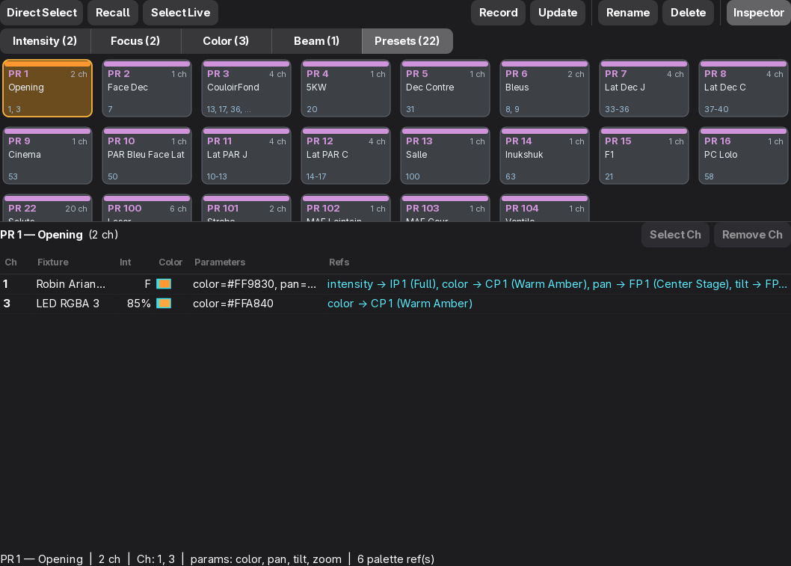

[English](../doc.en/palettes.md) | [← Sommaire](index.md)

# 8. Palettes & Presets

L'onglet **Palettes** (`Shift+Ctrl+L`) centralise les références réutilisables par famille d'attributs et les mémoires globales de paramètres :

## Catégories & Préfixes

Les onglets filtrent les enregistrements par type (avec compteur entre parenthèses) :
- **`Intensity` (`IP`)** : références d'intensité.
- **`Focus` (`FP`)** : références de position (`Pan`, `Tilt`).
- **`Color` (`CP`)** : références colorimétriques (`#FF9830`, teintes, émetteurs).
- **`Beam` (`BP`)** : références de faisceau (`Zoom`, `Focus`, `Iris`, `Strobe`, `Frost`, `Gobo`, `Prism`).
- **`Presets` (`PR`)** : enregistrements multi-familles (intensité + position + couleur + faisceau), pouvant eux-mêmes référencer en **cascade** d'autres palettes (`IP`, `FP`, `CP`, `BP`) comme illustré ci-dessus (`color -> CP1 (Warm Amber)`).

## Modes d'application & Contrôles

### Barre supérieure
- **`Direct Select`** : active le mode tactile/clic direct — un simple clic sur une tuile applique immédiatement la palette ou le preset sans confirmation supplémentaire.
- **`Recall`** : applique la palette sélectionnée.
  - **Si des circuits sont sélectionnés en Live**, la palette est appliquée **uniquement à cette sélection**.
  - **Si rien n'est sélectionné en Live**, la palette/le preset est appliqué(e) à **l'ensemble des circuits qu'il ou elle contient**.
  - **Retour en LiveView** : les valeurs rappelées en direct passent en **rouge (manuel)** pour signaler qu'elles sont envoyées par l'opérateur jusqu'à enregistrement ou `Sneak`.
- **`Select Live`** : sélectionne directement dans `LiveView` tous les circuits concernés par la palette ou le preset choisi.
- **`Record`**, **`Update`**, **`Rename`**, **`Delete`** : enregistrement depuis le live courant, mise à jour (avec propagation sur les cues/presets liés), renommage (`F2`) et suppression.
- **`Inspector`** : affiche ou masque le panneau inférieur détaillant chaque circuit stocké.

## Panneau `Inspector` & Barre de résumé

Lorsque **`Inspector`** est activé, le volet inférieur affiche :
- **Titre de l'élément sélectionné** (ex. `PR 1 — Opening (2 ch)`).
- Boutons d'action locale : **`Select Ch`** (sélectionne les circuits cochés/choisis dans l'inspecteur) et **`Remove Ch`** (retire un circuit de la palette/preset).
- Tableau détaillé : `Ch`, `Fixture`, `Int`, pastille `Color`, `Parameters` (valeurs stockées) et `Refs` (chaînes de références en cascade `param -> IP/FP/CP/BP`).
- **Pied de synthèse** : résume en une ligne l'identifiant, le label, le nombre de circuits, la liste des numéros de circuits, les familles concernées et le nombre de références de palettes.

## Commandes CLI équivalentes

- Appliquer : `IP 1`, `CP 2`, `PR 1` ou `1 THRU 4 CP 1`
- Enregistrer / Mettre à jour / Supprimer : `RECORD CP 3`, `UPDATE PR 1`, `DELETE FP 2`

---

*Précédent : [7. Inspecteur de projecteurs (Device Inspector)](device_inspector.md) — Suivant : [9. Groupes →](groups.md)*
