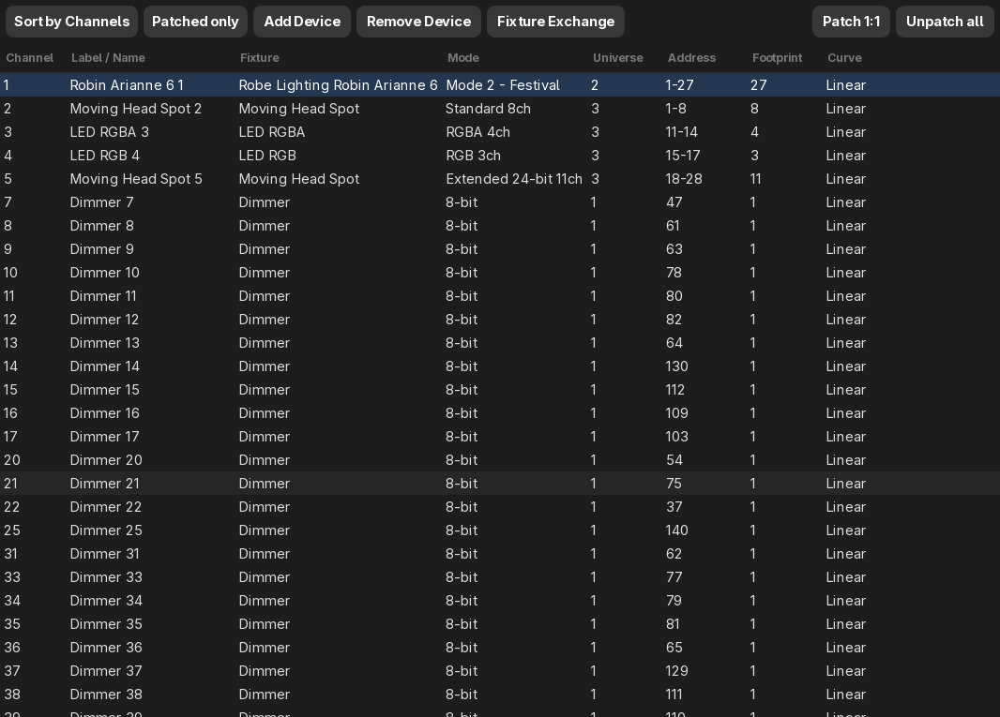
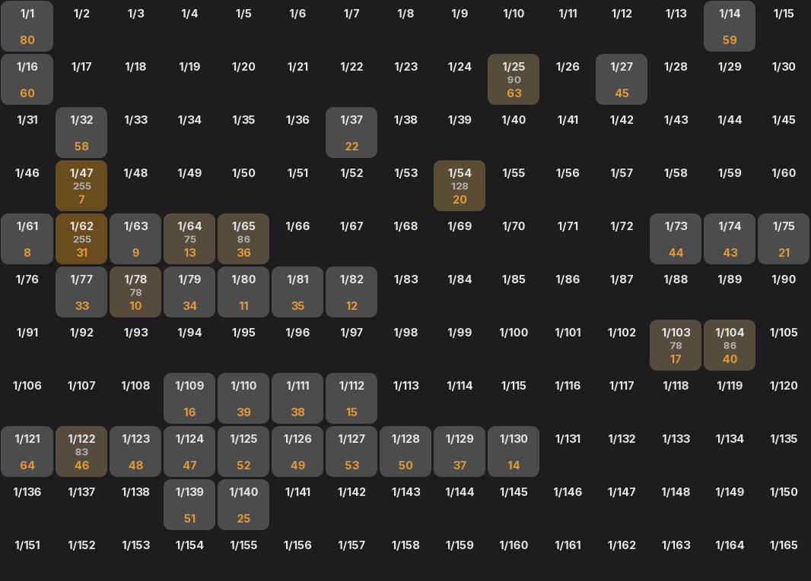

[English](../doc.en/patch.md) | [← Sommaire](index.md)

# 5. Patch & Sorties DMX

## Onglet Patch (`Ctrl+P`)

L'onglet **Patch** propose une vue centrée sur les circuits et les projecteurs (*devices*), associée à une barre d'outils dédiée en haut de l'onglet :

### Barre d'outils
- **Tri (`Sort by Channels` / par adresse DMX)** : bascule l'ordre des lignes et des colonnes entre vue logique (circuit d'abord) et vue physique (univers / adresse d'abord).
- **Filtre (`Patched only`)** : masque ou affiche les circuits non patchés.
- **`Add Device`** : ouvre l'assistant de création et de patch d'un ou plusieurs projecteurs multi-paramètres depuis la bibliothèque (y compris modèles importés en `.gdtf`) en affectant automatiquement numéro de circuit, mode DMX, univers et adresse de départ sans chevauchement.
- **`Remove Device`** : supprime le projecteur sélectionné (ou le remet à l'état non patché).
- **`Fixture Exchange`** : remplace le type ou le mode DMX d'un appareil déjà patché tout en conservant son numéro de circuit.
- **`Patch 1:1`** : associe directement les adresses aux circuits en correspondance directe 1 pour 1.
- **`Unpatch all`** : libère l'ensemble du patch (avec demande de confirmation).

### Tableau & Édition directe
Le tableau affiche : **`Channel`**, **`Label / Name`**, **`Fixture`**, **`Mode`**, **`Universe`**, **`Address`**, **`Footprint`** (empreinte DMX en canaux) et **`Curve`** (courbe de gradation assignée).

- Double-cliquez sur le label, le projecteur, le mode, l'adresse ou la courbe pour modifier l'élément directement via les menus contextuels intégrés.
- Vous pouvez aussi patcher/dépatcher au clavier :
  - `1 AT` -> `1 PATCH AT 1/10` ou `21 THRU 24 PATCH AT 2/1`
  - `1 UNPATCH` ou `ADDRESS 2/1 UNPATCH`

---

## Onglet Sorties DMX (`DMX Outputs` — `Ctrl+D`)

L'onglet **DMX Outputs** affiche en temps réel les **512 adresses DMX** de chaque univers configuré :

- **En-tête de tuile** : `Univers/Adresse` (ex. `1/47`, `1/62`).
- **Centre (blanc)** : valeur DMX actuelle sortie sur le réseau (`0..255`, masquée à zéro pour préserver la lisibilité).
- **Bas (ambre)** : numéro du circuit logique patché à cette adresse (ex. `7` sur `1/47`, `31` sur `1/62`).
- **Surbrillance** : les tuiles actives prennent une teinte ambrée proportionnelle à leur niveau de sortie.

---

*Précédent : [4. Fichiers, formats & import/export](files.md) — Suivant : [6. Bibliothèque de projecteurs & GDTF →](fixtures.md)*
