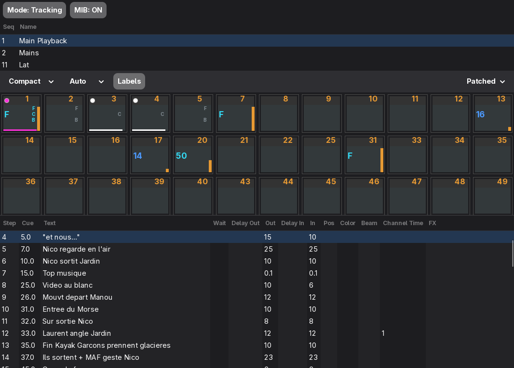

[English](../doc.en/sequences.md) | [← Sommaire](index.md)

# 12. Séquences, Tracking & MIB (`Sequences`)

L'onglet **Sequences** (`Ctrl+T`) permet d'éditer l'ensemble des séquences du spectacle (`1 Main Playback` ainsi que les séquences auxiliaires assignables aux faders) :

## Modes de conduite (`Tracking` & `MIB`)

En haut de l'onglet, deux boutons bascule pilotent le comportement de la séquence sélectionnée :

- **`Mode: Tracking` / `Mode: Cue-Only`** :
  - En mode **Tracking** (conduite à état continu), une valeur enregistrée reste active dans les mémoires suivantes tant qu'elle n'est pas modifiée explicitement, bloquée (`Block`) ou mise à zéro.
  - En mode **Cue-Only**, les modifications d'une mémoire restent isolées sans se propager en aval.
- **`MIB: ON` / `MIB: OFF` (*Move In Black*)** :
  - Anticipe automatiquement le pré-positionnement des projecteurs asservis (Pan/Tilt, Couleur, Faisceau) **pendant qu'ils sont au noir (intensité à 0 %)** juste avant leur ré-allumage, afin d'éviter des mouvements visibles à l'allumage.

## Organisation de l'onglet

1. **Liste des séquences** (haut) : colonnes `Seq` et `Name` (`1 Main Playback`, `2`, `11`, …).
2. **Grille `ChannelsView`** (centre) : affiche et permet d'ajuster directement les circuits de l'étape sélectionnée.
3. **Liste des étapes (`Steps`)** (bas) : tableau détaillé de toutes les mémoires de la séquence.

### Colonnes de la liste des étapes

| Colonne | Rôle |
| ------- | ---- |
| `Step` / `Cue` / `Text` | Indice interne d'étape, numéro de mémoire (décimal possible) et texte descriptif |
| `Wait` | Temps d'attente automatique avant enchaînement (si défini) |
| `Delay Out` / `Out` | Retard et durée de descente (*Fade Out*) |
| `Delay In` / `In` | Retard et durée de montée (*Fade In*) |
| `Pos` / `Color` / `Beam` | Temps de transition dédiés par famille d'attributs IFCB (hérités si vides) |
| `Channel Time` | Nombre de circuits dotés d'un temps individuel ; un **double-clic** ouvre l'éditeur de temps par circuit |
| `FX` | Statut des effets sur l'étape : **orange** (`FX <n>`, effet démarré), **cyan** (`FX <n> (T)`, effet suivi en tracking), **rouge** (`Stop FX`, arrêt d'effet) |

---

*Précédent : [11. Mémoires (Cues)](cues.md) — Suivant : [13. Faders multi-pages →](faders.md)*
