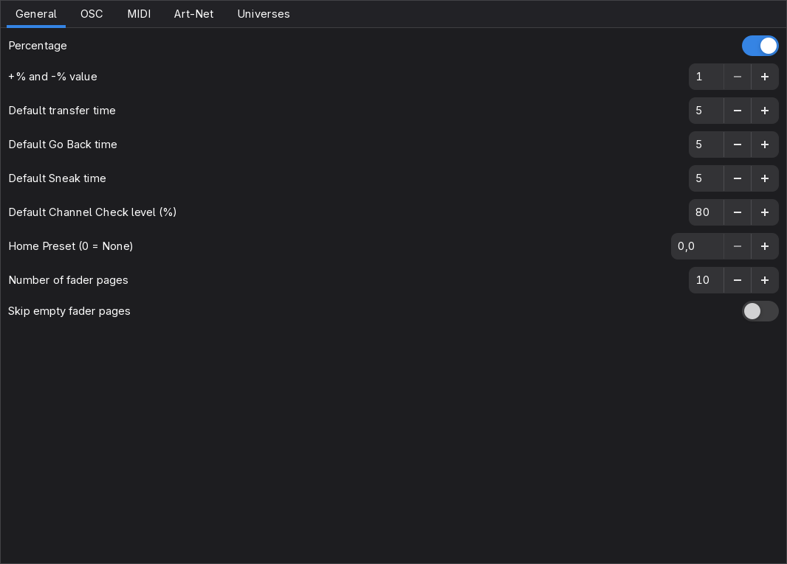
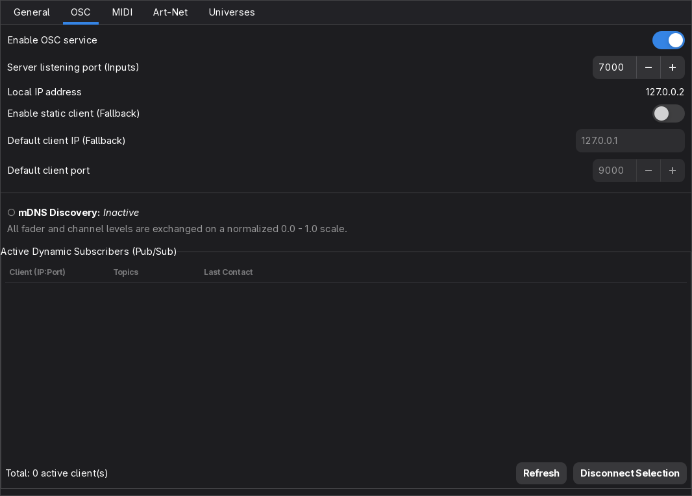
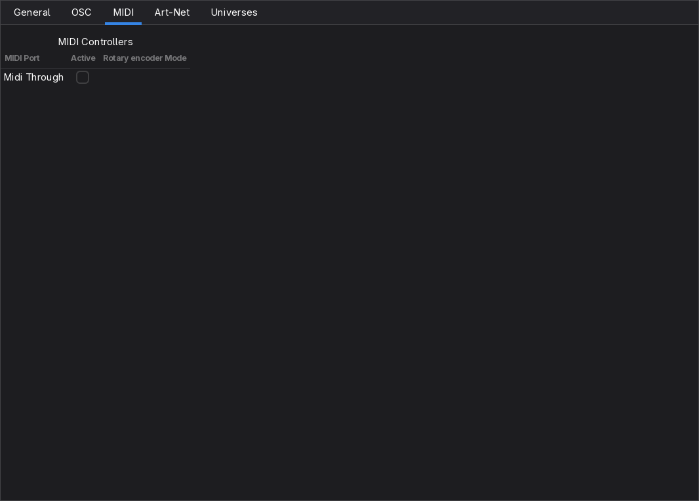
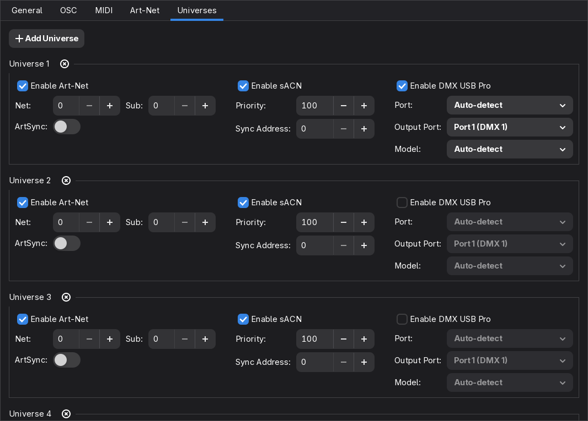

[English](../doc.en/settings.md) | [← Sommaire](index.md)

# 19. Préférences (`Preferences`)

L'onglet **Preferences** (accessible depuis le menu principal) est découpé en **5 sous-onglets** permettant de configurer à chaud l'ergonomie, les protocoles réseau, le MIDI et les sorties DMX :

## 1. Onglet `General` (Apparence & Comportement)

- **`Percentage`** : affiche les intensités en pourcentage (`0..100 %` / `F`) ou en valeurs DMX brutes (`0..255`).
- **`+ % and - % value`** : pas utilisé par les touches `+%` / `-%` (`Ctrl+Haut` / `Ctrl+Bas`, `5 %` par défaut).
- **`Default transfer time`** : durée de fondu par défaut lors de la création d'une mémoire (`5.0 s`).
- **`Default Go Back time`** : durée du retour arrière (`GoBack`, `2.0 s` par défaut dans le schéma).
- **`Default Sneak time`** : durée par défaut du relâchement `Sneak` (`5.0 s`).
- **`Default Channel Check level (%)`** : niveau appliqué lors d'un `CHECK` sans niveau explicite (`80 %` par défaut).
- **`Home Preset (0 = None)`** : numéro d'un `Preset` à rappeler comme état initial (`0.0` pour aucun).
- **`Number of fader pages`** : nombre total de pages du banc de faders (redimensionnable à chaud).
- **`Skip empty fader pages`** : saute automatiquement les pages dont tous les faders sont vides lors de `Page+` / `Page-`.

## 2. Onglet `OSC`

Configure le service OSC bidirectionnel, le port d'écoute (`7000`), le client de repli statique (`127.0.0.1:9000`), la découverte **mDNS / OSCQuery** et supervise en direct les **Active Dynamic Subscribers (Pub/Sub)** (avec boutons `Refresh` et `Disconnect Selection`). Voir [21. OSC, OSCQuery & TouchOSC](osc.md).

## 3. Onglet `MIDI`

Liste les ports MIDI détectés, permet d'activer/désactiver chaque interface et de choisir son **`Rotary encoder Mode`** (`Relative 1`, `Relative 2`, `Mackie`, `Absolute`). Voir [20. MIDI & Surfaces Mackie Control](midi.md).

## 4. Onglet `Art-Net`

Détecte les nœuds **Art-Net** présents sur le réseau local via *ArtPoll* / *ArtPollReply* et affiche leurs informations de configuration.

## 5. Onglet `Universes` (Sorties DMX)

Le bouton **`+ Add Universe`** ajoute de nouveaux univers DMX à chaud (chaque bloc peut être retiré via son icône de fermeture) :
- **Art-Net** : activation par univers, réglage `Net`, `Sub` et commutateur `ArtSync`.
- **sACN (E1.31)** : activation par univers, priorité (`Priority`, `100` par défaut) et `Sync Address`.
- **Enttec DMX USB Pro / Mk2** : activation série, détection automatique (`Auto-detect`) du port USB, sélection du port de sortie (`Port 1 (DMX 1)`, …) et du modèle.

---

*Précédent : [18. Historique (Undo History)](history.md) — Suivant : [20. MIDI & Surfaces Mackie Control →](midi.md)*
