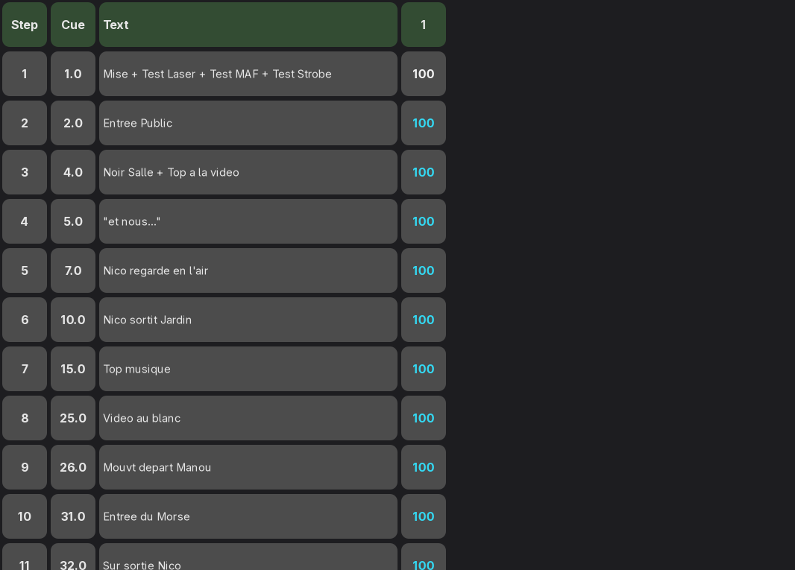

[English](../doc.en/track_channels.md) | [← Sommaire](index.md)

# 15. Suivi des circuits (`Track Channels`)

L'onglet **Track Channels** (`Shift+Ctrl+T`) affiche l'évolution chronologique d'un ou plusieurs circuits sélectionnés à travers toutes les mémoires de la séquence principale (`Main Playback`) :

## Fonctionnement

1. Sélectionnez un ou plusieurs circuits patchés dans `Channels` (ou via la ligne de commande, par exemple `1 THRU 4`).
2. Ouvrez **`Track Channels`** (`Shift+Ctrl+T`).
3. Chaque ligne correspond à une étape (`Step`, `Cue`, `Text`) et chaque colonne supplémentaire représente un circuit suivi.

## Lecture des états

Les niveaux s'affichent avec les **couleurs de tracking** de la console (montée, descente, maintien/suivi, blocage) en pourcentage ou en DMX selon le réglage `Percentage` des préférences. C'est l'outil idéal en répétition ou en encodage pour repérer d'un coup d'œil où un circuit s'allume, reste bloqué ou s'éteint sur toute la durée du spectacle.

---

*Précédent : [14. Courbes de gradation (Curves)](curves.md) — Suivant : [16. Indépendants (Independents) →](independents.md)*
