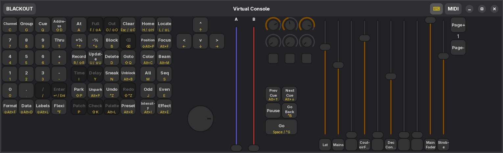

[English](../doc.en/virtual_console.md) | [← Sommaire](index.md)

# 17. Console virtuelle (`Virtual Console`)

La **Console virtuelle** (`Shift+Ctrl+C`) offre dans une fenêtre dédiée une surface de contrôle complète fidèlement synchronisée avec l'état de la console, les faders et le moteur OSC/MIDI :

## Barre de titre

- **`BLACKOUT`** : coupe immédiatement toute sortie DMX (équivalent de `Shift+Ctrl+B`).
- **Icône clavier (jaune lorsque active)** : affiche ou masque en permanence sur chaque touche l'aide des raccourcis clavier correspondants (également consultable ponctuellement en maintenant **`F1`**).
- **`MIDI`** : active ou quitte le mode d'apprentissage MIDI direct (*MIDI Learn*). Cliquez ensuite sur n'importe quel fader, rotatif ou bouton de la console virtuelle puis actionnez le contrôleur matériel correspondant pour les associer.

## Blocs fonctionnels

1. **Pavé numérique & Touches Eos** (gauche) : `Channel`, `Group`, `Cue`, `Address`, pavé `0..9`, `Thru`, `+`, `-`, `/`, `Enter`, accès rapide aux modes de vue (`Format`, `Data`, `Labels`, `Flexi`) et toutes les actions console (`At`, `Full`, `Out`, `Clear`, `+%`, `-%`, `Block`, `Record`, `Update`, `Delete`, `Goto`, `Time`, `Delay`, `Sneak`, `Unblock`, `Park`, `Unpark`, `Undo`, `Redo`, `Patch`, `Check`, `Palette`, `Preset`, `Home`, `Locate`, `Position`, `Focus`, `Color`, `Beam`, `All`, `Seq`, `Odd`, `Even`, `Intensity`, `Effect`).
2. **Navigation & Restitution manuelle** (centre) :
   - Croix directionnelle (`^`, `<`, `v`, `>`) et molette centrale de réglage de niveau.
   - **Double crossfade manuel `A` / `B`** (montée en bleu, descente en rouge).
   - Commandes de séquence principale : `Prev Cue`, `Next Cue`, `Pause`, `Go Back` et **`Go`**.
3. **Indépendants & Banc de Faders** (droite) :
   - **6 contrôles Indépendants** (rotatifs avec anneau d'état ambré + boutons poussoirs).
   - **10 faders motorisables avec boutons Flash**, afficheur de label dynamique sous chaque curseur (`Lat`, `Mains`, `Main Fader`, `Strobe`, …) et boutons **`Page+` / `Page-`** encadrant le numéro de page courant.

---

*Précédent : [16. Indépendants (Independents)](independents.md) — Suivant : [18. Historique (Undo History) →](history.md)*
