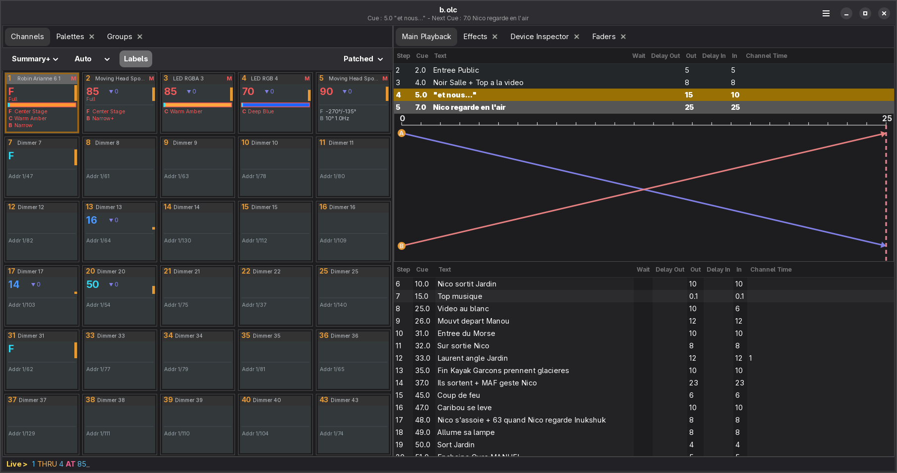
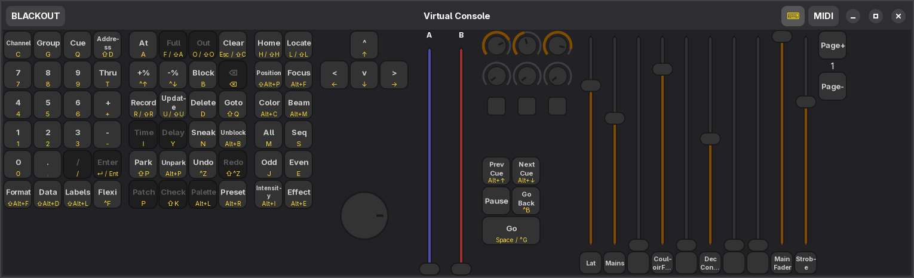

[English](index.md)

# Open Lighting Console

[](https://github.com/mikacousin/olc/releases/latest) [](https://github.com/mikacousin/olc/blob/master/COPYING)

**Open Lighting Console (`olc`)** (`0.12.0.beta`) est un jeu d'orgue open source pour Linux conçu pour le théâtre, le spectacle vivant et l'éclairage multi-paramètres. Il associe un moteur temps réel sans interface (`CoreEngine` à 44 Hz), une ligne de commande inspirée d'ETC Eos, la gestion complète de projecteurs asservis et LED, des effets paramétriques et une interface graphique GTK3.

> - **[Consulter le manuel utilisateur en français](doc.fr/index.md)**
> - **[Read the English User Manual](doc.en/index.md)**

## Aperçu

### Fenêtre principale



### Console virtuelle



## Fonctionnalités principales

- **Moteur DMX multi-protocole 44 Hz (`CoreEngine`)** :
  - Sorties multi-univers configurables à chaud en **Art-Net**, **sACN (E1.31)** et **Enttec DMX USB Pro / Mk2**, avec fusion **HTP DMX-In** et courbes de gradation personnalisées.
  - Traitement interne flottant `[0.0..1.0]` avec résolution **8 / 16 / 24 bits** et gradateurs virtuels (*virtual dimmers*).
- **Projecteurs asservis, GDTF et colorimétrie scientifique** :
  - Éditeur intégré **Fixtures Library** avec import **DIN SPEC 15800 (`.gdtf`)** et synchronisation directe du patch (`Add Device`, `Fixture Exchange`, `Patch 1:1`).
  - **Device Inspector (IFCB)** doté d'encodeurs 16 bits `Pan` / `Tilt`, d'un pavé tactile XY, de `Align to Lead`, `Locate` / `Home` et d'un sélecteur colorimétrique N-LED (solveur NNLS, diagramme **CIE 1931 xy**, teinte Duv, CCT et gélatines **Lee / Rosco** avec calcul de Delta E).
- **Vues Direct (LiveView), Tracking et Restitution** :
  - Trois mises en page `LiveView` (**Compact**, **Summary+**, **Table** dépliable avec pastilles couleur), cinq modes de lecture (`Auto`, `Label`, `Ref`, `Percent`, `DMX`) et filtres Flexi (`All`, `Patched`, `Active`, `Devices`, `Selected`, `Manual`).
  - Modes **Tracking** et **Cue-Only**, anticipation **Move In Black (MIB)**, temps séparés par famille **IFCB**, **Sneak** temporisé, **Park / Unpark** (circuits et adresses DMX) et **Channel Check / Address Check**.
- **Palettes, Presets, Groupes et Effets paramétriques** :
  - **Palettes** par catégorie (`IP`, `FP`, `CP`, `BP`) et **Presets (`PR`)** avec propagation en cascade, `Direct Select`, `Select Live` et panneau **Inspector** dépliable (`Select Ch`, `Remove Ch`). Tout rappel en direct applique les valeurs en manuel (affichage rouge).
  - **Groupes** ordonnés avec badges d'ordre (`#1`, `#2`, …), `Direct Select`, `Reverse`, `Sort` et création/édition en ligne de commande.
  - **Moteur d'effets paramétriques** avec 10 modèles intégrés, `Tap Tempo`, répartition Groups/Blocks/Wings/Axis°/Spread°, prévisualisation **Cairo 1D / 2D**, suivi dans les séquences et faders Size/Rate/Both.
- **Surfaces de contrôle, OSC, MIDI et outils compagnons** :
  - **Ligne de commande LL(1)** style ETC Eos, raccourcis clavier complets, **Console virtuelle** synchronisée (calque d'aide `F1`) et **Faders** multi-pages avec verrouillage `Fix`.
  - Format natif JSON `.olc` ainsi qu'import/export **USITT ASCII / ETC Eos**, **Historique Undo/Redo** complet et sauvegarde de l'espace de travail.
  - Apprentissage **MIDI** simplifié avec retour motorisé et écran **Mackie LCD**, **OSC** bidirectionnel (`0.0–1.0`) avec **OSCQuery**, découverte **mDNS** et templates **TouchOSC**.
  - Suite d'outils sans écran et de diagnostic : `olc-headless`, `olcd`, `olc-monitor`, `sacn-monitor` et `olc-bench`.

---

## Installation

### Paquets (recommandé pour les utilisateurs)

| Distribution | Paquet |
| ------------ | ------ |
| Flatpak | [](https://flathub.org/apps/details/com.github.mikacousin.olc) |
| Arch Linux | [](https://aur.archlinux.org/packages/olc-git) |

### Compilation depuis les sources

#### Dépendances principales

- Python >= 3.10, GTK3 >= 3.22, GObject Introspection >= 1.35.0, PyGObject >= 3.29.1, py3cairo
- `numpy`, `scipy`, `platformdirs`, `charset-normalizer`, `ifaddr`, `mido`, `python-rtmidi`, `pyserial`, `pyzmq`
- `textual` et `rich` (requis par `olc-monitor`)
- **Optionnel** : `pygdtf` (import GDTF), `zeroconf` (découverte mDNS OSCQuery étendue), `gtk4` + `libadwaita` (pour `sacn-monitor`)

#### Ubuntu / Debian

```bash
sudo apt install meson ninja-build gobject-introspection libgirepository1.0-dev libgtk-3-dev python3-gi python3-gi-dev python3-cairo-dev python3-gi-cairo gettext python3-numpy python3-scipy python3-platformdirs python3-charset-normalizer python3-ifaddr python3-mido python3-rtmidi python3-serial python3-zmq python3-textual python3-rich
```

Paquets optionnels :

```bash
sudo apt install gir1.2-gtk-4.0 gir1.2-adw-1 python3-zeroconf
pip install pygdtf
```

#### Compilation et installation

```bash
git clone https://github.com/mikacousin/olc.git
cd olc
meson setup builddir --prefix=/usr/local
sudo ninja -C builddir install
olc
```

---

## Sommaire de la documentation

- **[Sommaire (Français)](doc.fr/index.md)**
- **[Table of Contents (English)](doc.en/index.md)**

## Licence

Open Lighting Console est distribué sous licence **GNU General Public License v3.0 (GPLv3)**. Voir le fichier [COPYING](https://github.com/mikacousin/olc/blob/master/COPYING).
