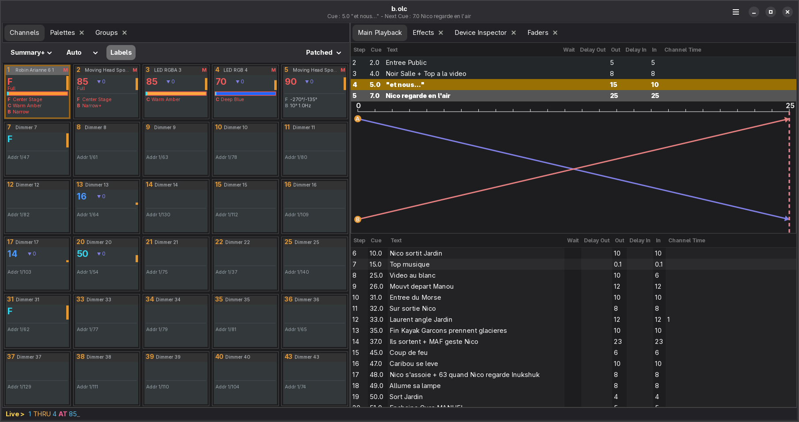
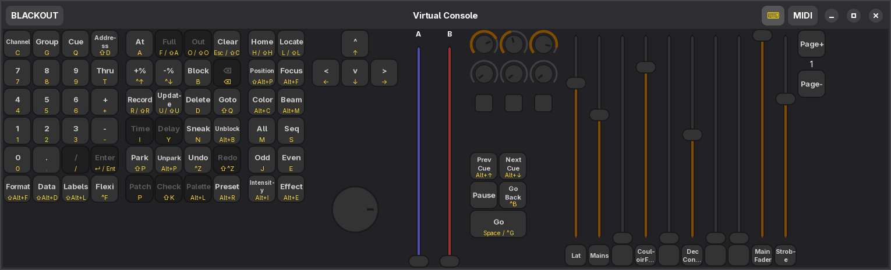

[Français](index.fr.md)

# Open Lighting Console

[](https://github.com/mikacousin/olc/releases/latest) [](https://github.com/mikacousin/olc/blob/master/COPYING)

**Open Lighting Console (`olc`)** (`0.12.0.beta`) is an Open Source Linux lighting console built for theater, live performance, and architectural experimentation. It combines a 44 Hz headless `CoreEngine`, an ETC Eos-inspired command line, multi-parameter intelligent fixture control, parametric effects, and a GTK3 graphical interface.

> [!NOTE]
> The documentation has been completely updated in both languages:
> - **[Read the English User Manual](doc.en/index.md)**
> - **[Lire le manuel utilisateur en français](doc.fr/index.md)**

## Overview

### Main Window



### Virtual Console



## Key Features

- **Multi-Protocol 44 Hz DMX Engine (`CoreEngine`)**:
  - Hot-configurable multi-universe DMX output over **Art-Net**, **sACN (E1.31)**, and **Enttec DMX USB Pro / Mk2**, with **HTP DMX-In** merging and custom dimmer curves.
  - Continuous `[0.0..1.0]` floating-point internal representation with **8 / 16 / 24-bit** resolution and virtual dimmers.
- **Intelligent Fixtures, GDTF & Scientific Colorimetry**:
  - Built-in **Fixture Library** editor with **DIN SPEC 15800 (`.gdtf`)** import and live patch synchronization (`Add Device`, `Fixture Exchange`, `Patch 1:1`).
  - **IFCB Device Inspector** featuring 16-bit `Pan` / `Tilt` encoders, 2D Pan/Tilt pad, `Align to Lead`, `Locate` / `Home`, and an **N-LED color picker** (NNLS spectral solver, **CIE 1931 xy** diagram, Duv tint, CCT, and **Lee / Rosco** gel swatchbooks with Delta E matching).
- **Live Views, Tracking & Playback**:
  - Three `LiveView` layouts (**Compact**, **Summary+**, expandable **Table** with live color swatches), five readout modes (`Auto`, `Label`, `Ref`, `Percent`, `DMX`), and Flexi channel filters (`All`, `Patched`, `Active`, `Devices`, `Selected`, `Manual`).
  - **Tracking** or **Cue-Only** modes, **Move In Black (MIB)** look-ahead, per-family **IFCB** cue timings, timed **Sneak**, **Park / Unpark** (channels and DMX addresses), and **Channel Check / Address Check**.
- **Palettes, Presets, Groups & Parametric Effects**:
  - Category **Palettes** (`IP`, `FP`, `CP`, `BP`) and **Presets (`PR`)** with cascade references, `Direct Select`, `Select Live`, and a collapsible content Inspector (`Select Ch`, `Remove Ch`). Live palette/preset recalls apply immediately in manual red override.
  - Ordered **Groups** with rank badges (`#1`, `#2`, …), `Direct Select`, `Reverse`, `Sort`, and CLI CRUD.
  - **Parametric Effects Engine** with 10 built-in templates, `Tap Tempo`, Groups/Blocks/Wings/Axis°/Spread° distribution, real-time **1D / 2D Cairo Visualizer**, cue tracking, and Size/Rate/Both faders.
- **Control Surfaces, OSC, MIDI & Companion Tools**:
  - **ETC Eos-inspired LL(1) command line**, customizable keyboard shortcuts, synchronized **Virtual Console** (`F1` overlay), and multi-page **Faders** with `Fix` pinning.
  - Native `.olc` JSON show files plus **USITT ASCII / ETC Eos** import & export, persistent **Undo History**, and workspace layout persistence.
  - Easy **MIDI** learn with motorized fader feedback & Mackie Control LCD, bidirectional **OSC** (`0.0–1.0`) with **OSCQuery**, **mDNS** discovery, and **TouchOSC** templates.
  - Headless & diagnostic suite: `olc-headless`, `olcd`, `olc-monitor`, `sacn-monitor`, and `olc-bench`.

---

## Installation

### Packages (Recommended for End Users)

| Distribution | Package |
| ------------ | ------- |
| Flatpak | [](https://flathub.org/apps/details/com.github.mikacousin.olc) |
| Arch Linux | [](https://aur.archlinux.org/packages/olc-git) |

### Building from Source

#### Core Dependencies

- Python >= 3.10, GTK3 >= 3.22, GObject Introspection >= 1.35.0, PyGObject >= 3.29.1, py3cairo
- `numpy`, `scipy`, `platformdirs`, `charset-normalizer`, `ifaddr`, `mido`, `python-rtmidi`, `pyserial`, `pyzmq`
- `textual` and `rich` (for `olc-monitor`)
- **Optional**: `pygdtf` (GDTF import), `zeroconf` (enhanced mDNS OSCQuery), `gtk4` + `libadwaita` (for `sacn-monitor`)

#### Ubuntu / Debian

```bash
sudo apt install meson ninja-build gobject-introspection libgirepository1.0-dev libgtk-3-dev python3-gi python3-gi-dev python3-cairo-dev python3-gi-cairo gettext python3-numpy python3-scipy python3-platformdirs python3-charset-normalizer python3-ifaddr python3-mido python3-rtmidi python3-serial python3-zmq python3-textual python3-rich
```

Optional packages:

```bash
sudo apt install gir1.2-gtk-4.0 gir1.2-adw-1 python3-zeroconf
pip install pygdtf
```

#### Build & Install

```bash
git clone https://github.com/mikacousin/olc.git
cd olc
meson setup builddir --prefix=/usr/local
sudo ninja -C builddir install
olc
```

---

## Documentation Index

- **[Table of Contents (English)](doc.en/index.md)**
- **[Sommaire (Français)](doc.fr/index.md)**

## License

Open Lighting Console is distributed under the **GNU General Public License v3.0 (GPLv3)**. See [COPYING](https://github.com/mikacousin/olc/blob/master/COPYING) for details.
